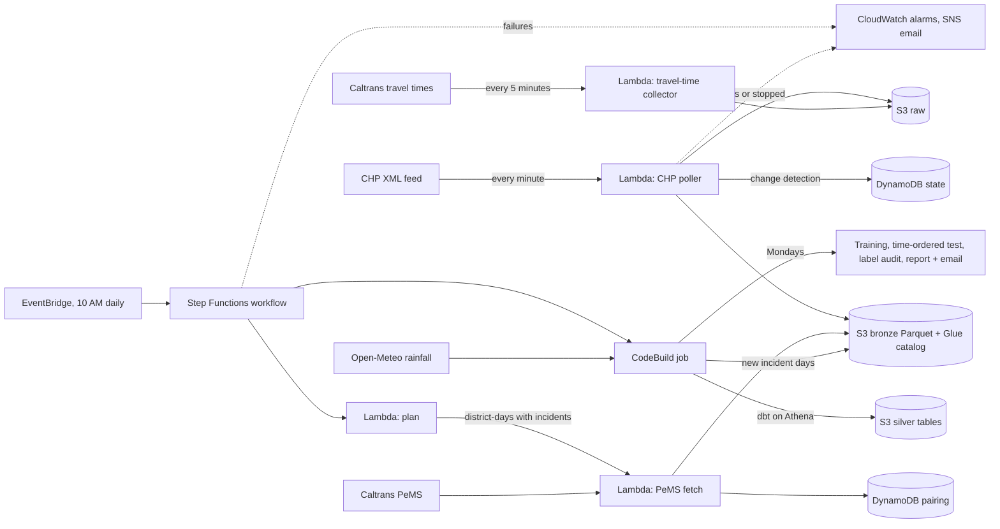

# Predicting Freeway Backups From CHP Incident Reports

When the California Highway Patrol logs a crash on a California freeway, will traffic back up behind
it, and for how long? This project collects every CHP incident and every freeway sensor reading around
it, builds labeled examples on AWS, and trains models to answer both questions from what is known
minutes after the crash is reported.

**Status (November 9, 2026):** the pipeline has six weeks of live data (Sept 29 – Nov 8: 14,211
labeled incidents across Southern California and, since October 13, the Bay Area) and, since
November 2, ten months of PeMS history for training (114,056 incidents in all, from January 1).
Tested the way it would be used, trained on everything through November 1 and predicting the next
week of live crashes (3,642 incidents):

| What the model is allowed to see | Model AUC | Rule-based baseline | Improvement (95% range) |
|---|---|---|---|
| **CHP report + normal traffic at that spot** (runs today) | **0.766** | 0.690 | **+0.076** (+0.067 to +0.091) |
| + traffic in the 30 minutes before the crash (needs a real-time sensor feed) | 0.812 | 0.690 | +0.122 (+0.105 to +0.140) |
| + traffic since the crash | 0.925 | 0.849 | not a prediction; see [below](#live-traffic-is-detection-not-prediction) |

The model beats the baseline reliably, and holding out each live week in turn gives the same picture
(0.767 vs. 0.681). Ten months of history raised both deployable models (from 0.744 to 0.766 and from
0.797 to 0.812 on the same week, [Section 9](#did-the-history-help)), but the gain from more data is
flattening: the limit now looks like what the CHP report says in its first minutes, not the amount of
training data. **How long** a backup lasts is better than the baseline but still hard to predict
(C-index 0.62). The sections below explain the target, the test design, the statistics, the alerting
tradeoff, whether retraining helps, and where the model fails.

---

## Contents

1. [Data sources](#1-data-sources)
2. [Architecture](#2-architecture)
3. [From raw feeds to labels](#3-from-raw-feeds-to-labels)
4. [Prediction target](#4-prediction-target)
5. [Features and when each is available](#5-features-and-when-each-is-available)
6. [Baseline](#6-baseline)
7. [Experimental design](#7-experimental-design)
8. [Statistical inference](#8-statistical-inference)
9. [Results](#9-results)
10. [Missing a backup vs. an unnecessary alert](#10-missing-a-backup-vs-an-unnecessary-alert)
11. [Does weekly retraining help?](#11-does-weekly-retraining-help)
12. [Failure cases](#12-failure-cases)
13. [Checking the labels](#13-checking-the-labels)
14. [Engineering details](#14-engineering-details)
15. [Limitations and what's next](#15-limitations-and-whats-next)
16. [Repository layout](#16-repository-layout)
17. [Running it](#17-running-it)

---

## 1. Data sources

| Source | What it gives | How it's collected |
|---|---|---|
| [CHP live incident feed](https://media.chp.ca.gov/sa_xml/sa.xml) | Every open CHP incident statewide: type, location, coordinates, dispatcher notes (lanes blocked, vehicles, ambulance, tow, SigAlert...), and unit events | Polled **every minute**. The feed only shows *current* incidents, so history exists only from when collection started |
| [Caltrans PeMS](https://pems.dot.ca.gov/) | Speed, flow and occupancy every 5 minutes from thousands of freeway loop detectors, plus sensor locations, lane counts and types (mainline, on/off-ramps, freeway connectors) | Daily files per Caltrans district, downloaded each morning (about a one-day lag) |
| [Open-Meteo](https://open-meteo.com/) | Hourly rainfall on a 0.25° grid (about 25 km) | Fetched each morning for every grid cell and day with CHP incidents; the first run backfilled from September 29 |
| [PeMS CHP incident history](https://pems.dot.ca.gov/) | PeMS's own record of every CHP incident, dispatcher note and unit event, one statewide file a day | Backfilled for days before the poller started (January 2026 on), training only ([details](#training-on-pems-history-added-november-2)) |
| [Caltrans travel times](https://cwwp2.dot.ca.gov/documentation/tt/tt.htm) | Current travel time on selected freeway segments in districts 3, 8, 11 and 12, refreshed every 5 minutes | Saved raw **every 5 minutes** since late October 2026, to build history for a model that runs live (PeMS arrives a day late) |
| [Caltrans lane closures](https://cwwp2.dot.ca.gov/documentation/lcs/lcs.htm) | Every approved lane, ramp and road closure for the next 7 days and the ones in place now: lanes closed, location, and when crews reported it started and ended | Saved raw **every 5 minutes** from October 30, 2026; parsed each morning. Current closures only, so no history before that |
| [TomTom Traffic Flow](https://docs.tomtom.com/traffic-api/documentation/traffic-flow/flow-segment-data) | Current and free-flow speed on the road segment at a point | One lookup per new freeway incident, **the moment the poller first sees it** (free tier: at most 600 a day) |
| [OpenStreetMap](https://www.openstreetmap.org/) | Every freeway and ramp: lanes, speed limit, bridges, where ramps join and leave | Downloaded once (refreshed every 90 days); every incident is placed on its carriageway, including past ones |
| Calendar and sun position | Holidays, long weekends, getaway days, winter break, clock changes; how high the sun is and whether it's in the driver's eyes | Computed (`transform/seeds/calendar_days.csv`), so it covers every past incident too |

**Coverage:** the 8 Southern California CHP dispatch centers (Caltrans districts 7, 8, 11 and 12: Los
Angeles/Ventura, Inland Empire, San Diego, Orange County), plus the Bay Area (district 4) since October
13. The feed carries roughly 1,000 to 2,800 incidents a day across these centers. Labeled incidents
by dispatch center: Bay Area 2,099, Inland Empire 2,083, San Diego 2,072, Los Angeles 1,733, Orange
County 214, others under 110.

**Why Los Angeles and Orange County are under-represented.** Los Angeles logs more than twice as many
incidents as any other center, yet has fewer labels. Tracing every incident from the feed to a label
(`scripts/pipeline_status.py`) shows where they drop out: almost all are located on a freeway and near a
sensor, but most have **no working sensor** in the 5 miles behind the crash. PeMS sensors tend to
either measure all day or not at all (filled in by PeMS from neighbors and history), and filled-in
readings can't show a backup:

| Caltrans district | Mainline sensor-days with no real measurements (last 7 days) |
|---|---|
| 7 (Los Angeles / Ventura) | 86% |
| 8 (Inland Empire) | 59% |
| 11 (San Diego) | 58% |
| 12 (Orange County) | 50% |
| 4 (Bay Area) | 45% |

This is a property of the source data, not a pipeline bug, so relaxing the sensor-health rule wouldn't
help (sensors are rarely partly working). Orange County went from 1 label in its first 3 weeks to 214
as its sensors came back. The models only describe crashes on well-instrumented freeway segments.

## 2. Architecture

Everything runs in AWS on serverless services, deployed as one SAM/CloudFormation stack, so it keeps
running with no machine to keep on.



| Layer | Tech |
|---|---|
| Ingestion | Python 3.14 Lambdas (requests, pandas, awswrangler), EventBridge Scheduler, Open-Meteo weather API |
| Orchestration | Step Functions (plan -> fetch each district-day -> report -> process) |
| Storage | S3 data lake (raw / bronze / silver), Parquet, Glue Data Catalog, DynamoDB |
| Transformation | dbt (dbt-athena) on Amazon Athena (Trino SQL), with unit tests and data tests |
| ML | XGBoost (classifier + accelerated-failure-time survival model), scikit-learn, a hand-written log-normal survival model |
| Automation & monitoring | CodeBuild scheduled job, CloudWatch alarms, SNS email, a one-command pipeline health report |
| Infrastructure as code | AWS SAM / CloudFormation |

**Only paired data is analyzed.** Traffic files are downloaded only for district-days that had CHP
incidents, and CHP incidents are only analyzed when their district-day has traffic data. A small
pairing table tracks each district-day (`pending`, `paired`, `no_incidents`, `unpaired`), so a day
when either collector was down is kept but excluded rather than silently mislabeled.

## 3. From raw feeds to labels

The dbt project (`transform/`) turns the raw tables into one labeled row per incident:

1. **Staging.** Each incident's latest version; freeway and direction parsed from CHP's location
   text. US-101 needs special handling: CHP calls the Valley/Ventura stretch east/west, but PeMS
   calls all of it north/south. Also: dispatcher notes with the time the poller first saw them,
   sensor metadata, and 5-minute readings.
2. **Sensor health.** About two thirds of mainline sensors report imputed (filled-in) values rather
   than real measurements. A sensor only counts on days when at least 80% of its readings were measured.
3. **Which sensors belong to an incident.** The incident is placed on the freeway by its nearest
   mainline sensor. Sensors are then assigned roles relative to the direction of travel:
   - **queue:** 0 to 5 miles upstream, where a backup forms;
   - **approach:** 5 to 10 miles upstream, traffic about to arrive;
   - **merge:** on-ramps and freeway connectors feeding the queue zone;
   - **exit:** off-ramps.

   Postmiles increase northbound and eastbound, so "upstream" is a lower postmile for N/E traffic
   and a higher one for S/W.
4. **What "normal" traffic is.** Each reading's expected speed is the sensor's *typical* speed for
   that 5-minute slot on other weekdays (or weekends), scaled by how traffic was running in the 30
   minutes before the crash. The incident's own day is left out, so the crash's slowdown never
   counts as normal. With fewer than 3 days of history, it falls back to the pre-crash speed.
5. **The label** (`int_backup_slots`, `fct_incident_backup`), defined in [Section 4](#4-prediction-target).
6. **Training rows** (`fct_training_landmarks`): one row per incident at 5, 10, 20 and 30 minutes
   after the CHP log time, containing only what was known at that moment, plus the target.
7. **Duplicate reports removed** (`ml/backup_model.py`, before any model sees the data). Freeway
   Service Patrol tow trucks log their own incidents, and about half of those are the same crash CHP
   already logged: same freeway and direction, within 30 minutes, at the same sensor. Both copies get
   the same label, so keeping them counts one crash twice. CHP also occasionally opens a second
   incident for the same crash. Each group of duplicates keeps one report (CHP over FSP, then the
   earliest); 11,834 were dropped, and every duplicate pair had the same label.

**No look-ahead.** Notes count only once the poller had actually seen them, traffic only once a
5-minute reading had finished, and rows from before the poller first saw an incident are dropped.

## 4. Prediction target

**The question is asked at a checkpoint**: 5, 10, 20 or 30 minutes after CHP logs an incident, using
only what was known at that moment.

| | Target | Type |
|---|---|---|
| **Primary** | Will traffic at the crash be backed up at any point after this checkpoint? | binary |
| Secondary | If so, how many more minutes until it is back to normal? | time to event, right-censored |

**Definitions:**
- **Backed up:** the sensor nearest the crash (within 1 mile upstream), and an unbroken run of sensors
  behind it, is below 60% of the speed expected for that spot and time, or at least 30% occupied with
  no speed reading (stopped traffic often has no measurable speed).
- **Start:** the first time this lasts at least 10 minutes, within 45 minutes of the log time.
- **Back to normal:** the crash site is above 80% of expected speed for 15 straight minutes.
- **Censored:** still backed up when the 3-hour window ends or the sensors stop reporting. The
  duration is then known only to be *at least* that long.

About 13% of incidents cause a backup; the typical one lasts 50 minutes.

**Why the target is set up this way:**
- **Asked at a checkpoint, not "at the crash".** A traffic operator decides at a moment in time with
  what is known then. One row per incident per checkpoint gives every row a well-defined information
  set, and the same incident is asked again as more is known. Predicting from the full incident record
  would quietly use notes written after the decision.
- **"Any more backup after now", not "did it ever back up".** At 20 minutes, a backup that already
  ended is no longer actionable. The target covers the two cases that still matter: a backup that
  hasn't started yet and one still going. (The second case is what makes the live-traffic model look
  better than it is; see [Section 9](#live-traffic-is-detection-not-prediction).)
- **Compared to expected speed, not a fixed mph.** 35 mph is a backup at 2 AM and normal on the 405 at
  5 PM. Comparing to the same spot's typical speed for that time slot separates crash-caused slowdowns
  from everyday congestion.
- **60% to start, 80% to end.** The gap stops one brief improvement from ending a backup.
- **Censored backups kept.** Dropping backups that outlast the window would remove exactly the longest
  ones and bias durations short. The survival models use them as lower bounds.

## 5. Features and when each is available

About 60 inputs per row. A feature is only usable if it exists at the checkpoint *in production*, not
just in the historical table, so the models are trained on three feature sets.

| Group | Examples | Available at the checkpoint? | History only | + Pre-crash | + Live |
|---|---|---|:---:|:---:|:---:|
| CHP report | incident type, lanes blocked now (latest note) and how many, all lanes, lanes reopened, vehicles, ambulance, tow, fire, SigAlert, overturned, hazmat, fatality, units assigned / on scene | **Yes**, within about a minute (poller). Only notes seen by the checkpoint count | ✓ | ✓ | ✓ |
| Time | hour, day of week, rush hour, weekend | **Yes** | ✓ | ✓ | ✓ |
| The road | lanes at the crash site and upstream, merge points, sensors in the queue zone | **Yes**, sensor metadata changes rarely | ✓ | ✓ | ✓ |
| Normal congestion at this spot | how slow it usually is now, in 30 and in 60 minutes, minutes until it usually flows freely | **Yes**, from earlier days | ✓ | ✓ | ✓ |
| Normal congestion along the backup zone | slowest sensor 0–5 miles back now / in 30 / in 60 minutes, zone average, share of the zone normally jammed, average 5–10 miles back | **Yes**, from earlier days | ✓ | ✓ | ✓ |
| Rain *(collected, not a model input yet)* | rain in the last 1, 3 and 24 full hours at the incident's grid cell | **Yes**, hourly weather is published in real time | | | |
| Road layout, calendar, lane closures, speed at report *(collected, not model inputs yet; see [More context data](#more-context-data-added-october-29))* | lane drop ahead, ramps nearby, curve; holiday, long weekend, getaway day, darkness, sun glare; closures in place; TomTom speed when the incident was first seen | **Yes**: map data and calendars are known in advance, closures are published ahead, the speed lookup runs within a minute or two of the report | | | |
| Traffic before the crash | speed, occupancy and flow at the site and across the queue zone, their 15-minute trend, traffic arriving from upstream, on-ramp / connector / off-ramp volume, **demand vs. capacity left** (vehicles arriving ÷ what the open lanes carry at about 2,000 vehicles/hour/lane) | **Only with a real-time sensor feed.** This pipeline gets PeMS files the next morning | | ✓ | ✓ |
| Traffic since the crash | how slow it is now, whether it's backed up, how far back it reaches, minutes slowed so far | **Only with a real-time sensor feed** | | | ✓ |

- **CHP + history only** is the model that could run today with this pipeline.
- **CHP + pre-crash** needs same-day sensor data for the 30 minutes before the crash, so it needs a
  near real-time sensor feed, which isn't built yet.
- **+ Live** sees the backup itself forming, so it measures detection, not prediction.

Location identifiers (freeway, district, dispatch center) are deliberately excluded, so a model can't
memorize which corridors happened to have long backups in a few weeks of data.

## 6. Baseline

**Rule:** for a new incident, predict the share of past training incidents in the same group that
backed up, and that group's median remaining time (Kaplan-Meier, so censored backups count as lower
bounds). Groups are checkpoint × lanes blocked (none / 1 / 2+ / all) × incident type, plus "backed up
right now" in the live variant. Groups with fewer than 10 past incidents fall back to a coarser group.

**Why this baseline:** it is the strongest thing you could do without a model, a lookup table a traffic
center could keep by hand, and it already uses the most obvious signals (lanes blocked, incident
type). A model is only worth running if it beats this, so results are reported as **model minus
rule**, not as raw scores.

Two models are compared against it:

| Method | Will it back up? | How much longer? |
|---|---|---|
| **Boosted** | XGBoost classifier | XGBoost survival model (accelerated failure time) that learns from censored durations |
| **Simple** | logistic regression on about 15 features | log-normal survival model with readable effects ("+X% duration per blocked lane") |

## 7. Experimental design

Three evaluations answer three different questions:

| Evaluation | Question | How |
|---|---|---|
| **Forward test** (`ml/forward_test.py`) | How would it have done if deployed on a date, predicting only the future? | Train on every day before the latest live week, test on that week |
| **Week held out** (`ml/evaluate.py`) | Using all the data, how well does each method rank incidents? | Hold out one week of live days, train on everything else (history included), predict the held-out week, repeat for every live week. History rows are never scored ([Training on PeMS history](#training-on-pems-history-added-november-2)). With fewer than four live weeks it holds out one day at a time instead |
| **Retraining simulation** (`ml/forward_test.py`) | Does retraining every Monday make predictions better? | A model frozen at the first of the last four Mondays vs. one retrained each Monday, scored on the same later days |

**Time periods (November 9 report):**

| | Dates | Days | Incidents |
|---|---|---|---|
| All data | Jan 1 – Nov 8, 2026 | 310 | 114,056 (454,207 checkpoint rows) |
| Live days (the only ones scored) | Sept 29 – Nov 8 | 41 | 14,211 |
| Forward test: training | Jan 1 – Nov 1 | 303 | 110,414 |
| Forward test: testing | Nov 2 – Nov 8 | 7 (Mon to Sun, so every weekday and both weekend days) | 3,642 |
| Week held out: test weeks | Sept 29 – Nov 8 | 6 weeks | 1,040 to 3,642 per week |
| Retraining: frozen model trained on | Jan 1 – Oct 11 | 284 | |
| Retraining: weekly models trained on | everything before Oct 19, Oct 26, Nov 2 | | |
| Model development (the October experiments) | Sept 29 – Oct 14 | 16 | |

**Why each choice:**
- **Both a forward test and week held out.** Holding out each week uses every live day for testing and
  keeps each week together. But it trains on days *after* the ones it predicts, which a real system
  never can. If something drifts over time (season, construction, how CHP writes notes), it hides it.
  The forward test is the honest deployment number; week held out is the more precise one. They agree
  (history only: 0.766 vs. 0.767; pre-crash: 0.812 vs. 0.805), which suggests no drift.
- **Model changes chosen on early days only.** Every setting and feature idea was judged on days before
  October 15 (a time-ordered split plus leave-one-day-out within those days). The later days were used
  once, at the end, so the reported gain isn't the best of many tries on the test data.
- **Whole days (or weeks) as the unit of splitting.** Incidents on the same day share weather, events
  and traffic level, and each incident appears at up to four checkpoints. Splitting rows at random
  would put near-copies of a test row in training and inflate every score.
- **A full test week.** Seven consecutive days include every weekday and a weekend, so the test isn't
  tilted toward one kind of day.
- **Alert thresholds fixed before the test days.** Picking the threshold that looks best on the test
  days and reporting precision and recall there is optimistic by construction. Cost-based thresholds
  come from a formula ([Section 10](#10-missing-a-backup-vs-an-unnecessary-alert)); the "catch 80%"
  threshold is chosen on the last fifth of the *training* days by a model fit on the earlier ones.
- **Number of trees chosen on the latest training days.** Early stopping on a random split would reward
  trees that fit day-specific noise. Holding out the most recent days mirrors how the model is used.
- **Three feature sets.** They separate "is the model good" from "is the model usable". A strong score
  that depends on data we won't have at decision time is not a deployable result.
- **A frozen vs. retrained comparison on the same days.** Comparing this week's model to last week's on
  different test weeks would mix "did the model improve" with "was this week easier". Scoring both on
  identical rows isolates the effect of retraining.
- **Primary comparison named in advance:** boosted minus rule, AUC, CHP + history only, forward test.
  Everything else is secondary. Naming one comparison up front keeps the many tables below from becoming
  a search for a good-looking number.

## 8. Statistical inference

**The unit of inference is the day.** All 95% intervals come from a **cluster bootstrap over days**:
resample the test days with replacement, recompute every score on the incidents from those days,
repeat 200 times, and take the 2.5th and 97.5th percentiles. Incident-level intervals would treat
thousands of correlated rows as independent and come out far too narrow. With a 7-day forward test, the
honest sample size is 7, and the intervals are wide accordingly.

**Comparisons are paired.** "Boosted minus rule" and "retrained minus frozen" are computed on the same
resampled days in each bootstrap draw. Day-to-day swings (a heavy-crash Friday) cancel out of the
difference, so the comparison is much more precise than two separate intervals would suggest. A model
is said to beat the rule when the whole interval of the difference is above zero.

**Metrics, and why each:**

| Metric | What it measures | Why it's here |
|---|---|---|
| **AUC** | chance a random incident that backs up is ranked above one that doesn't (0.5 = guessing) | threshold-free, so methods can be compared on ranking alone |
| **Average precision** (area under the precision-recall curve) | precision averaged over all recall levels; guessing scores the backup rate, about 0.13 | backups are rare, and AUC can look fine while most alerts are wrong; this metric shows that |
| **Precision / recall** at a fixed threshold | of alerts sent, how many were real; of real backups, how many got an alert | what an operator actually experiences |
| **Brier score** | mean squared error of the probability | rewards honest probabilities, not just ranking |
| **Calibration table** | do incidents given 30% back up about 30% of the time? | the cost-based alert thresholds assume calibrated probabilities |
| **C-index** (Harrell's) | how often the duration model orders two backups' remaining time correctly (0.5 = guessing) | handles censoring correctly |

**Censoring is handled in every statistic.** Durations still going at the end of the window are never
treated as if they ended there: the rule uses the Kaplan-Meier median, the boosted survival model uses
interval-censored likelihood (a lower bound with no upper bound), the log-normal model uses the
survival function for censored rows, and the C-index only counts pairs whose order is known.

**What "significant" means here.** With six live weeks to test on, an interval that includes zero means "not
shown yet", not "no effect". Results are reported as estimates with intervals rather than pass/fail
tests, and the primary comparison is named in advance (above), so one lucky interval out of many isn't
presented as a finding.

**Reproducibility.** Model and bootstrap seeds are fixed, so reruns on the same data give the same
numbers.

## 9. Results

Every score below comes from live days (days the poller saw); PeMS history is used for training only
([Training on PeMS history](#training-on-pems-history-added-november-2)). Training data: Jan 1 –
Nov 8, 2026, 114,056 incidents after dropping 11,834 duplicate reports. "95% range" is the
day-resampled interval.

### Will it back up?

**Forward test** (the primary result): trained on Jan 1 – Nov 1 (110,414 incidents), tested on the
next week of live crashes (Nov 2–8, 3,642 incidents), all checkpoints together:

| Feature set | Method | AUC | Average precision | Precision* | Recall* |
|---|---|---|---|---|---|
| **CHP + history only** | Rule | 0.690 | 0.287 | 0.338 | 0.425 |
| | Boosted | **0.766** | **0.389** | **0.360** | **0.497** |
| | Boosted − rule | **+0.076 (+0.067 to +0.091)** | +0.103 (+0.082 to +0.129) | +0.022 (+0.002 to +0.051) | +0.071 (+0.033 to +0.090) |
| **CHP + pre-crash traffic** | Rule | 0.690 | 0.287 | 0.338 | 0.425 |
| | Boosted | **0.812** | **0.462** | **0.389** | **0.580** |
| | Boosted − rule | +0.122 (+0.105 to +0.140) | +0.176 (+0.152 to +0.203) | +0.051 (+0.037 to +0.070) | +0.154 (+0.125 to +0.183) |

<sub>*At the threshold for "a missed backup costs 4× an unnecessary alert" (alert when P > 0.2), fixed in advance; see Section 10.</sub>

**Week held out** (each of the 6 live weeks predicted by a model trained on everything else):

| Feature set | Rule AUC | Boosted AUC | Boosted − rule | Simple (linear) − rule |
|---|---|---|---|---|
| CHP + history only | 0.681 | **0.767** | **+0.085 (+0.073 to +0.097)** | −0.014 (−0.031 to +0.003) |
| CHP + pre-crash traffic | 0.681 | **0.805** | **+0.124 (+0.110 to +0.135)** | +0.022 (+0.002 to +0.038) |

- **The model beats the rule in both deployable settings, in both tests.** The primary comparison
  (history only, forward test, +0.076) has its whole interval above zero, and the two tests agree
  within 0.01, so there's no sign of drift between the October weeks and the newest one.
- **At the same threshold, the model catches more backups with at least as good precision.**
- **The simple model is no better than the rule** without pre-crash traffic (−0.014, interval spans
  zero; on the forward test −0.016). The whole gain comes from interactions a linear model can't
  express, such as incident type × time of day × normal congestion.
- **Earlier is nearly as good as later.** From CHP + history, AUC is 0.755 at the 5-minute checkpoint,
  0.758 at 10, 0.771 at 20 and 0.780 at 30 minutes (pre-crash: 0.799 to 0.811). The useful signal is
  there from the first report; later notes add a little.
- **What it leans on:** incident type, how congested the spot normally is now and in 30 minutes,
  number of vehicles, and whether CHP has said lanes are blocked.
- **Probabilities are calibrated up to about 0.2** (predicted 0.031 / 0.073 / 0.142, actual 0.033 /
  0.077 / 0.143), and **too low above that** (predicted 0.277 → actual 0.319; 0.488 → 0.574). So an
  alert threshold above 0.2 is stricter than its formula intends.

### Did the history help?

Yes, steadily, and with diminishing returns. The same test week (Nov 2–8), predicted from the most
recent N days of training data:

| Training days | 7 | 28 | 112 | 303 (all) |
|---|---|---|---|---|
| History only, AUC | 0.738 | 0.752 | 0.760 | **0.766** |
| Pre-crash, AUC | 0.771 | 0.796 | 0.805 | **0.812** |
| Rule, AUC | 0.678 | 0.686 | 0.689 | 0.690 |

Going from about what the live data alone gave (28 days) to all history adds +0.014 and +0.016; each
fourfold increase in data adds about half as much as the one before. The paired check behind model
promotion agrees: on the same new week, the model trained with history beats the one trained through
October 28 without it by +0.022 (+0.009 to +0.034) for history only and +0.015 (+0.004 to +0.027) for
pre-crash, so both were promoted.

**Before the history** (trained on 21 live days, tested Oct 20–26), the same comparison gave 0.74 vs.
0.66 for history only and 0.78 for pre-crash. Those numbers aren't comparable to the ones above (a
different test week, and normal-congestion features that still looked a few weeks ahead), so their
tables have been dropped from this README; the experiments below are from that period.

### Improving the models

*These experiments ran in October, on the first weeks of live data and before the PeMS history, so
their absolute numbers are lower than the ones above. What carries over is which changes helped.*

The goal was to make the two deployable models (history only, and pre-crash) better. Every idea was
scored only on days before October 15, two ways: trained before October 8 and tested October 8–14, and
leave-one-day-out within those days. Scores are AUC.

| Change | History only (time split / leave-one-out) | Pre-crash (time split / leave-one-out) | Kept? |
|---|---|---|---|
| Starting point (after removing duplicates) | 0.682 / 0.687 | 0.739 / 0.742 | |
| **Shallower, more regularized trees** (depth 3, ≥20 incidents per leaf, slower learning) | **0.687 / 0.692** | **0.756 / 0.749** | **yes** |
| + incidents in the past 1–3 hours on the same road / in the same district | 0.688 / 0.688 | 0.761 / 0.748 | no |
| + each freeway's past backup rate (from earlier days only) | 0.679 / 0.692 | 0.752 / 0.748 | no |
| + 16 features from CHP's own words (on a ramp or connector, shoulder, big rig, motorcycle, debris, injuries, traffic break...) | 0.680 / 0.694 | 0.759 / 0.749 | no |
| Average of boosted and simple models | 0.694 / 0.692 | 0.758 / 0.745 | no |
| CatBoost instead of XGBoost | 0.700 / 0.691 | 0.760 / 0.728 | no |
| Dropping weak features (day of week, unit counts, sensor counts) | within ±0.005 | | no |

**Second round, after the tables were rebuilt with the new columns** (same development days and splits;
the starting point is higher than in the table above because "typical traffic" for each sensor is now
built from four weeks of other days instead of three, which most likely sharpened both the labels and
the normal-congestion features for the early days):

| Change | History only (time split / leave-one-out) | Pre-crash (time split / leave-one-out) | Kept? |
|---|---|---|---|
| Starting point | 0.707 / 0.706 | 0.755 / 0.755 | |
| **+ normal congestion along the whole backup zone** | **0.716 / 0.719** | **0.761 / 0.763** | **yes** |
| + rain in the last 1, 3 and 24 hours | 0.707 / 0.713 | 0.759 / 0.755 | not yet |
| + both | 0.708 / 0.719 | 0.760 / 0.764 | |

Only changes that helped on both splits were kept. The CHP text was the most promising idea and the
most disappointing: some words do matter on their own (debris: 8% backed up vs. 14%; injuries: 20% vs.
13%), but the model already gets that from incident type, vehicles and ambulance.

**Final check on days never used before** (trained before October 22, tested October 22–26):

| | Before the changes | After | Change (95% range) | vs. rule |
|---|---|---|---|---|
| History only | 0.716 | 0.720 | +0.004 (+0.001 to +0.010) | +0.05 (+0.01 to +0.08) |
| Pre-crash | 0.765 | 0.772 | +0.007 (0.000 to +0.023) | +0.11 (+0.09 to +0.12) |

The improvement is real but small. Removing duplicates mostly made the numbers more honest rather than
higher.

**The zone features on the latest week** (trained before October 21, tested October 21–27): history only
0.736 → 0.737 (+0.001, −0.010 to +0.012); pre-crash 0.782 → 0.782. They helped on the development days
but make no measurable difference on the newest week. They stay in the models because they're computed
anyway and cost nothing at prediction time, but they aren't counted as an improvement.

**Rain** isn't used yet. Re-tested on October 29 with the corrected rainfall (the first version was
stamped an hour late): on the development days it moved AUC by less than 0.005 either way (history
only 0.705 → 0.701 on the time split, 0.706 → 0.707 leave-one-out; pre-crash 0.756 → 0.761 and
0.758 → 0.760). Across all 30 days, `ml/feature_check.py` found no difference for the history-only
model and a small *loss* for the pre-crash one (−0.003, 95% range −0.005 to −0.001). It has rained on
only about 10% of reports in the 3 hours before, and those backed up *less* often (9.6% vs. 13.8%, 229
reports), probably because traffic was already slow and the "typical speed" baseline doesn't know it's
raining. It needs a real rainy season before it can be judged; the pipeline collects it every day.

### More context data (added October 29)

With these inputs the models seem close to their limit, so the next lever is new kinds of data.
Four sources were added, each chosen because it plausibly changes how a crash plays out and is known
**when the prediction is made**, so none needs PeMS:

| Group | Features | Why it might help | History |
|---|---|---|---|
| Lane closures (Caltrans) | closure in place within ~1.5 km, same freeway and direction; lanes closed; full closure; planned but unconfirmed closure | A crash inside a work zone hits a road that has already lost lanes | From Oct 30 |
| Speed at report (TomTom) | current / free-flow speed when the poller first saw the incident; road shown closed; data confidence | The one live "how slow is it right now" signal, also where PeMS sensors are dead. Kept only if the lookup landed on a freeway heading the incident's way | From the day the key is added |
| Road layout (OpenStreetMap) | lanes; lanes lost within 1 mile ahead; off-ramps ahead and on-ramps behind within 1 mile; distance to each; curve; speed limit; bridge | A lane drop ahead or on-ramps pouring in behind turns a small crash into a jam | All incidents |
| Calendar | holiday; day before or after one; long weekend; getaway day (the last workday before one); winter break; the week after the clocks change; Halloween / Christmas Eve / New Year's Eve; sun height; dark; low sun within 30° of the direction of travel | "Typical traffic" is built from ordinary weekdays and weekends, so it's wrong on exactly these days; glare and darkness change how drivers react | All incidents |

**How each group is judged before it's used.** None of them is in `FEATURES` yet. Every Monday,
`ml/feature_check.py` tests each group: it keeps only incidents where the group exists (so "newer days"
can't pose as "better data"), splits those days into five groups, trains on four and scores the fifth,
and compares the same model with and without the group, with a 95% range from resampling days. A group
joins the models only if the gain is above zero on the development days and holds on later weeks,
the same bar every other change had to clear. Road layout and calendar can be judged on the first
Monday, since they cover past incidents. Lane closures and speed at report start from zero and
need a few weeks; until then the check reports "not enough data yet".

**Caveats known up front.** The TomTom lookup happens when the poller first sees the incident, a few
minutes after the crash, so a slowdown it shows is partly the crash itself. That's still fair for a
model run at that moment (it's what a live system would know), but it's detection more than prediction,
the same distinction as [live traffic](#live-traffic-is-detection-not-prediction). Lane closure crews
don't always radio the start of a closure, so "planned" closures are kept as a separate, weaker
feature. Placing a crash on the right carriageway uses the reported direction; where a freeway's
signed direction differs from its compass heading (US-101 through the San Fernando Valley) it can pick
the wrong side.

### Training on PeMS history (added November 2)

Live collection only grows a day at a time, and the CHP feed shows only open incidents, so the past
can't be collected from it. But PeMS keeps its own record of CHP incidents (Clearinghouse type
`chp_incidents_day`: one statewide zip a day, with every incident and every dispatcher note and unit
event), and PeMS sensor data goes back years. Together they rebuild the same training rows for days
before the poller existed.

**Checked first, on the 5 weeks where both exist** (`scripts/history_vs_live.py`):

| Question | Answer |
|---|---|
| Does PeMS have our crashes? | About 65% of the labeled ones on a normal day. The ones it has look like the ones it lacks (14.2% vs. 13.9% backed up; 30% vs. 30% blocking lanes) |
| Is every PeMS day complete? | No. Some days are missing most incidents (Oct 2: 72 statewide instead of ~1,400; Oct 27: 37). Hours with fewer than a quarter of the usual incidents for that hour of the week are dropped |
| Same log times? | Yes: within 2 minutes, almost always identical |
| Same notes? | 92% of the notes our poller saw are in PeMS, with the same text |
| Same note times? | No. Our poller saw each note a median 1.8 minutes after PeMS's time for it (PeMS rounds down to the minute; the poller checks once a minute), within 4 minutes for 95%, more than 10 minutes late for about 2%. History notes count as known 3 minutes after PeMS's time |

**How history is used** (`stg_chp_incidents`, `stg_chp_notes`, `stg_chp_units`):
- Only where the poller has nothing: before it started, the hours it was down (12 hours on Nov 2),
  and the Bay Area before it was added on Oct 13. Precisely: district-hours with no live incident,
  in the districts the poller covers, from complete hours, so no crash is counted twice.
- First-seen and closure-detected times, which PeMS doesn't have, are set to what the poller would
  typically have recorded: seen a minute after the log time, closure noticed 3 minutes after the end.
- History rows are **training data only**. Every score in this README comes from days the poller
  saw: evaluation holds out one live week at a time (or one live day, while there are fewer than four
  weeks), the forward test's last week is live, and history is never in a test set, not even
  history that fills an outage hour inside a test week. So the extra
  data can only help a score by making the model better on live data, not by being easier to predict.
- "Typical traffic" now uses days within 6 weeks of the incident, so months of history don't mix
  seasons. For the **normal-congestion features** it uses only the 6 weeks *before* the crash, as a
  live model would; the label's baseline may still use days on both sides, since the label is
  judged after the fact.

**Loading it:** `scripts/backfill_chp_history.py` (incident files, a few minutes), then
`scripts/backfill_pems.py` (sensor files: one per district per day, downloaded in the background by
the `PemsBackfillWorkflow` in AWS, about a day or two for Jan–Sep). Rainfall for the history days
comes in over the next few daily runs (Open-Meteo's free daily limit).

### Live traffic is detection, not prediction

With traffic since the crash, AUC is 0.925 on the forward test (rule 0.849) and 0.921 with each week
held out. That number is real, but it does not measure *prediction*. The target counts backups already
underway, and the live model's score climbs with the checkpoint (0.846 at 5 minutes, 0.971 at 30) as
the backup becomes visible in the sensors.

Scoring only rows that were **not yet backed up** at the checkpoint (forward test):

| Feature set | Model AUC, all rows | Model AUC, not yet backed up | Rule, not yet backed up |
|---|---|---|---|
| CHP + history only | 0.766 | 0.749 | 0.689 |
| CHP + pre-crash | 0.812 | 0.774 | 0.689 |
| + Live | 0.925 | 0.859 | 0.711 |

Even here, the live model scores 0.86 because it sees speeds already falling toward the backup
threshold. That's useful (an automatic detector that fires before the label's 10-minute rule), but it
is detecting a forming queue, not predicting one from the report. The headline numbers in this README
are therefore the history-only and pre-crash models.

### How long?

| Feature set | Rule C-index | Boosted C-index | Boosted − rule | Median error (boosted vs rule) |
|---|---|---|---|---|
| CHP + history only | 0.561 | 0.617 | +0.056 (+0.040 to +0.068) | 18.8 vs 21.0 min |
| CHP + pre-crash | 0.561 | 0.640 | +0.080 (+0.062 to +0.094) | 18.8 vs 21.0 min |

<sub>Week-held-out C-index on rows still backed up at the checkpoint (0.5 = guessing). The forward test agrees: history only 0.612 vs. 0.570 (+0.041, +0.010 to +0.066); pre-crash 0.621 (+0.050, +0.030 to +0.067).</sub>

Duration is still hard. Both models beat the rule with room to spare, and the history-only C-index
is up from 0.58 in October, but 0.62 still ranks durations only moderately
better than chance, and the typical miss is about 19 minutes. The simple survival model's effects
(history only) make sense:

- **Overturned vehicle:** about 26% longer;
- **SigAlert:** about 31% longer;
- **Each additional vehicle:** about 10% longer;
- **Ambulance:** about 11% longer;
- **Rush hour starting soon:** about 27% longer;
- **All lanes blocked:** about 12% *shorter* (CHP "traffic breaks", see [Section 13](#13-checking-the-labels)).

The weekend effect from the 4-week data (27% shorter) is gone (−1%): the normal-congestion features
already say how busy the road is.

## 10. Missing a backup vs. an unnecessary alert

A probability only becomes useful once someone decides when to act on it. The two mistakes cost
different things:

- **Missed backup:** drivers keep heading into a queue nobody warned them about; the tail of the queue
  is where secondary crashes happen; diversion and response start late.
- **Unnecessary alert:** a message sign or app warning for traffic that never stopped. Each one is
  cheap, but many of them teach operators and drivers to ignore alerts, which makes the real ones worth
  less.

**Choosing a threshold.** If a missed backup costs *k* times an unnecessary alert, alerting has lower
expected cost whenever *p* × *k* > (1 − *p*), that is, when *p* > 1 / (1 + *k*). This only works if *p*
is calibrated, which is why the calibration check above matters. The thresholds come from this formula,
not from the test data.

At the 5-minute checkpoint, CHP + history only, over the 7 test days (Nov 2–8: about 470 incidents
and 65 backups a day across five districts):

| Missed backup costs | Alert when P > | Precision | Recall | Alerts / day | Missed backups / day | Unneeded alerts / day |
|---|---|---|---|---|---|---|
| 1× an unneeded alert | 0.50 | 0.70 | 0.06 | 5 | 62 | 2 |
| 2× | 0.33 | 0.49 | 0.24 | 32 | 50 | 16 |
| **4×** | **0.20** | **0.35** | **0.52** | **97** | **32** | **64** |
| 9× | 0.10 | 0.22 | 0.82 | 250 | 12 | 196 |
| catch 80% (set on training days) | 0.09 | 0.21 | 0.84 | 268 | 11 | 213 |
| *Rule at 4×* | *0.20* | *0.35* | *0.42* | *79* | *38* | *52* |
| *Rule at 9×* | *0.10* | *0.22* | *0.66* | *200* | *22* | *157* |
| *CHP + pre-crash at 4×* | *0.20* | *0.37* | *0.58* | *102* | *27* | *64* |
| *CHP + pre-crash at 9×* | *0.10* | *0.25* | *0.84* | *218* | *11* | *163* |

**The practical tradeoff:**
- **There is no setting that is both quiet and complete.** Catching four out of five backups means
  about 250 alerts a day, four out of five of them unnecessary. The strictest setting is right 70% of
  the time but catches only 6% of backups.
- **The model's advantage is reach, not precision.** At every shared setting its alerts are right about
  as often as the rule's (0.35 vs. 0.35 at 4×, 0.22 vs. 0.22 at 9×), but it is willing to flag more
  incidents with good reason: at 4× it catches 6 more backups a day for 12 more unneeded alerts, and at
  9× it catches 82% of backups where the rule can't get past 66% at any threshold (the rule's
  probabilities come in a few coarse steps, so "catch 80%" falls back to the same 0.66).
- **Because probabilities above 0.2 run low** ([calibration](#will-it-back-up)), the 2× and 1× rows
  probably alert less than the formula intends; their actual precision (0.49, 0.70) is higher than the formula aims for.
- **For a traffic operations dashboard,** a missed backup is plausibly 4 or more times worse than an
  extra item on a list someone glances at: about half the backups caught, one alert in three right.
- **For public warnings** (message signs, navigation apps), false alarms cost trust, so a cost ratio
  near 2× is more realistic, and at that setting the model warns about only one backup in four.
- **The better use right now is ranking, not alarms.** Sorting incidents by probability, an operator who
  works down the list until half the backups are covered finds a real one in 38% of the incidents they
  look at, almost three times the base rate of 14%.
- **Real-time pre-crash traffic is worth more than any threshold choice:** at the same 4× setting it
  catches 58% of backups instead of 52%, with the same number of unneeded alerts.

## 11. Does weekly retraining help?

The scheduled job retrains every Monday. That only matters if it changes predictions for the better.

**With ten months of history (November 9): no measurable effect.** The retraining simulation compares,
on the same rows, a model frozen at the first of the last four Mondays (trained Jan 1 – Oct 11) with
one retrained on Oct 19, Oct 26 and Nov 2 on all data so far, scored on the weeks after each retrain:

| Feature set | Frozen AUC | Weekly AUC | Weekly − frozen (95% range) |
|---|---|---|---|
| CHP + history only | 0.779 | 0.779 | +0.000 (−0.001 to +0.001) |
| CHP + pre-crash | 0.811 | 0.812 | +0.001 (−0.000 to +0.002) |
| *Rule* | *0.694* | *0.694* | *−0.000 (−0.001 to +0.001)* |

The interval is narrow enough to rule out any effect bigger than about 0.002. One more week barely
moves a model that has already seen 40 weeks, and there's still no sign of drift: the week-held-out
and forward-test scores agree, and the learning curve ([Section 9](#did-the-history-help)) shows the
gain coming from *amount* of data, not recency.

**Promotion still guards every retrain** (`ml/promote.py`): the job trains this week's code on
everything except the latest 7 days, scores it against the current model on those 7 days (which
neither has seen), and keeps whichever ranks them better. On November 9 the challenger (with history)
beat the champion (trained through Oct 28 on live data only) by +0.022 (+0.009 to +0.034) for history
only and +0.015 (+0.004 to +0.027) for pre-crash, so both were promoted. The decision and its interval
go into the weekly email. Retraining stays on the schedule because it costs nothing and lets code and
feature changes reach the deployed model, not because one more week of data is expected to help.

**Earlier, with only a few weeks of data** (frozen on Sept 29 – Oct 4, retrained Oct 12, 19 and 26,
scored Oct 12–26), retraining did help: +0.015 (−0.002 to +0.032) for history only and +0.023
(+0.006 to +0.036) for pre-crash. The gain was in Southern California, where the frozen model had only
6 days of history, and the learning curve then rose until about 10 days. Both point to the same
conclusion as now: retraining helps exactly as long as the history is short.

## 12. Failure cases

From the forward test (Nov 2–8), CHP + history only, at the 5-minute checkpoint and the 4× threshold:

| | Caught backups | Missed backups | Unneeded alerts | Correctly no alert |
|---|---|---|---|---|
| Incidents | 236 | 222 | 446 | 2,410 |
| Lane blocked (per CHP notes) | 61% | **29%** | 45% | 25% |
| Night (9 PM to 5 AM) | 1% | **11%** | 1% | 12% |
| 2 or fewer working sensors behind the crash | 11% | **19%** | 14% | 24% |
| Label from a partial baseline | 0.4% | 1.8% | 1.6% | 1.9% |
| Weekday rush hour | 70% | 48% | 65% | 46% |
| Normally congested at this time | 30% | 19% | **32%** | 13% |
| Traffic already slower than usual before the crash | 34% | 23% | **21%** | 9% |
| Median backup length | 55 min | 45 min | | |

**What it misses:**
1. **Backups CHP hasn't described.** Seven in ten missed backups had no lane-blocked note at 5 minutes,
   and the lowest-scored misses are almost all "1125, traffic hazard" with nothing blocking and speeds
   near normal. The model leans on the CHP report, so a crash that sounds harmless gets a low score.
   AUC where no lanes are blocked: 0.71 (lanes blocked: 0.79).
2. **Night backups.** Backups at night are rare (7.7% vs. 13.8% by day), so the model scores night
   crashes low and the few that do back up are missed: 11% of misses vs. 1% of catches. Ranking within
   the night is only a little worse (AUC 0.74 vs. 0.77); the problem is that none of them reaches the
   threshold.
3. **Thinly instrumented spots.** 19% of missed backups had 2 or fewer working sensors behind the
   crash, vs. 11% of caught ones. AUC there is about the same (0.76), so this looks like weaker features
   rather than worse labels. The partial-baseline labels that stood out in October are now rare (under
   2% of every column) because the baseline has more days to draw on.
4. **Shorter backups.** Missed backups are shorter (median 45 vs. 55 minutes), so the misses skew toward
   the ones that matter less.

**Where it raises unneeded alerts:**
1. **Severe-looking crashes in heavy traffic.** Unneeded alerts are mostly lanes-blocked crashes at
   rush hour, and they're more than twice as likely as correct no-alerts to be at a spot that is
   normally congested at that time (32% vs. 13%) or already slower than usual (21% vs. 9%). The label
   compares to *typical* speed, so where it's normally jammed, a crash may not push speeds below 60% of
   an already low baseline. AUC where traffic was already slow: 0.70; normally congested: 0.72.
2. **SigAlerts.** Only 54 rows in the test week, 54% backed up, and the model can't tell which ones will
   clear quickly (AUC 0.63).

## 13. Checking the labels

Labels built from sensor rules can be quietly wrong, so they were audited before more modeling
(`ml/label_audit.py`). The audit has two parts:

1. **Severity check:** if labels are right, severe incidents should back up more often and longer.
2. **Trace check:** a page with speed charts for random backups, plus "no backup" incidents where CHP
   said lanes were blocked, with the label's start and end drawn on.

The first audit found four kinds of mistakes, all now fixed and covered by unit tests built from the
real cases:

| Problem | Example from the audit | Fix |
|---|---|---|
| Single 5-minute dips counted as backups | a one-reading dip to 59% of expected | backup must last at least 10 minutes |
| Slowdowns 2 to 5 miles back counted even when traffic at the crash was normal | a separate bottleneck kept one "backup" alive for 165 minutes | the queue must start within 1 mile of the crash and be unbroken |
| Recovery declared too early | speeds crawled at about 80% for 15 minutes, then collapsed for two more hours; the label said 5 minutes | recovery requires 80% of expected, not 60% |
| Late starts missed | a drop to 15 mph starting 33 minutes after the log time was labeled "no backup" | onset window widened to 45 minutes |

Severity still lines up the way it should with 28 days (8,385 incidents):

| Incident flag | Backed up (yes vs no) | Median minutes (yes vs no) |
|---|---|---|
| SigAlert issued | 48% vs 13% | 70 vs 50 |
| Overturned vehicle | 35% vs 13% | 65 vs 50 |
| Ambulance | 30% vs 12% | 55 vs 50 |
| Tow requested | 23% vs 11% | 50 vs 50 |
| Any lane blocked | 20% vs 10% | 50 vs 50 |
| Weekday rush hour | 16% vs 12% | 55 vs 45 |
| Weekend | 11% vs 14% | 35 vs 55 |
| All lanes blocked | 28% vs 13% | **35 vs 50** |

**Why "all lanes blocked" is shorter:** CHP often holds all lanes on purpose for a few minutes (a
"traffic break") to clear debris or let a tow truck work. The note says "all lanes", but the stop is
brief by design. It's a real effect, not a label error.

## 14. Engineering details

- **Change detection.** The poller hashes each incident and writes only new or changed incidents
  (about 5,000 rows a day instead of about 90,000). Closures are detected when an incident has been
  missing for 3 consecutive polls.
- **Overlapping runs can't corrupt state.** State is one DynamoDB item with an optimistic version
  lock. A slower overlapping run that loses the version check exits cleanly as "superseded".
- **Defensive parsing.** An error page or empty document returned with HTTP 200 is rejected instead
  of being read as "every incident closed", and a download cut off mid-document is retried (on
  October 28 the CHP feed started returning cut-off files for hours). One unreadable timestamp
  doesn't stop a poll.
- **A stuck container replaces itself.** On November 2 one poller container got the same cut-off
  copy of the feed (exactly 172,032 bytes) on every try for about 12 hours, while a new container got
  the full feed at once; incidents that opened and closed in that window were lost. Retries now ask
  for an uncached copy, and after 3 failed polls in a row the container exits so Lambda starts the
  next poll in a fresh one.
- **Idempotent loads.** PeMS district-days are written with partition overwrite, so retries and
  reprocessing never duplicate rows. A day that parses to zero rows is retried, not marked done.
- **Automation.** After each morning's download, a CodeBuild job rebuilds every dbt table. On Mondays
  it also retrains, runs the time-ordered test (forward test, alert tradeoff, retraining comparison,
  failure cases), replaces the stored model only if the retrained one is at least as good, reruns the
  label audit, saves everything to S3 and emails a summary. It first
  removes leftover temporary tables from failed dbt runs, so one failure can't block the next day.
- **Monitoring.** Alarms email on poller errors, on the poller stopping (fewer than 30 runs an hour),
  on the travel-time collector failing for an hour,
  and on any failed daily workflow. `scripts/pipeline_status.py` prints one report covering every
  stage: firing alarms, whether the alert email is confirmed, runs and errors per hour for both
  collectors with their latest error messages, recent workflow and job runs with the
  error from the latest failure, row counts per day from raw incidents through training rows, sensor
  health by district, and how many incidents each dispatch center loses at each step on the way to a
  label.
- **Tests.**
  - **Python:** 142 pytest tests, covering parsing, change detection, PeMS, the models, both
    evaluations, duplicate removal, model promotion, the rainfall download, the travel-time collector and
    the job scripts.
  - **dbt:** 18 unit tests, built from real CHP notes and real audit cases, plus data tests.
  - **Mutation testing:** key label rules were checked by breaking each one on purpose and confirming
    a test fails.

**Outage, October 14–22.** Collection kept running, but no new incidents were labeled for 8 days.
Three problems stacked up:
1. The scheduled job's code had never been uploaded to S3, so every run failed before starting.
2. Once it was uploaded, dbt failed replacing a view: the job's IAM role could create Glue tables but
   not read and prune a view's old versions (`glue:GetTableVersions`), which dbt-athena needs the
   second time it builds a view.
3. The failure alerts weren't reaching the inbox; the email subscription had to be sent again and
   confirmed.

The fixes: the missing permissions plus a test that keeps them, the health report above, and a
confirmed alert subscription. Because raw data is kept, nothing was lost; one rebuild labeled all 8 days,
and the daily job has run cleanly every day since.

## 15. Limitations and what's next

**Limitations:**
- **Six live weeks to test on.** Training now covers ten months, but every score comes from
  September 29 – November 8, and the forward test is a single week, so a holiday or storm in it would
  move every number. Winter and summer have never been tested.
- **History is not a perfect copy of live data.** PeMS has about 65% of the crashes the poller sees,
  some PeMS days are mostly missing (those hours are dropped), and first-seen and closure times are
  set to typical values because PeMS doesn't record them ([Training on PeMS history](#training-on-pems-history-added-november-2)).
  Scores are on live data only, so this can only cost accuracy, not inflate it.
- **Labels come from sensors.** A backup the sensors can't see (no working sensor within a mile) isn't
  in the data, so results apply to well-instrumented freeway segments. Most Los Angeles sensors never
  report real measurements ([Section 1](#1-data-sources)), so Los Angeles is under-represented.
- **Pre-crash and live results assume a real-time feed** the pipeline doesn't have yet.
- **Typical speed in the label and the pre-crash features uses days on both sides** of the incident
  (within 6 weeks). That's right for the label; for "speed vs. typical before the crash" (pre-crash
  model only) it's a mild look-ahead. The normal-congestion features use only earlier days (all scores
  in Sections 9–12; the October experiments in [Improving the models](#improving-the-models) predate
  this). Free-flow speed per sensor is computed over all days.
- **Small timing gaps in the notes.** About 2% of history notes still count as known more than
  10 minutes early after the 3-minute shift, and unit events use CHP's own time stamps, which run
  a minute or two ahead of when the poller saw them.
- **Probabilities above 0.2 run low** (0.49 predicted, 0.57 actual in the top band), so the strict
  alert settings fire less than their cost ratio intends. Recalibrating on the latest live weeks would
  fix it.

**What's next:**
- **Judge the new context data.** The first `ml/feature_check.py` results for calendar, road layout,
  lane closures and TomTom speed come in the November 16 report (the November 9 run reached its time
  limit before that step). Groups that help on held-out live days join the models.
- **Real-time sensor data,** which turns the pre-crash model (0.812 vs. 0.766) into something
  deployable. This is still the largest available gain, bigger than everything in
  [Improving the models](#improving-the-models) and bigger than ten months of history.
- **Better coverage of crashes CHP hasn't described yet:** the misses are mostly hazards with no
  blocking note. TomTom speed at report and the Caltrans travel times are the best candidates, since
  they see the road where the CHP text says nothing.
- **Use the Caltrans travel times** once there are a few weeks of them: a live "how slow is it right
  now" signal for San Diego, Orange County and the Inland Empire.
- **Rain, after the rainy season starts:** both as a model input and in the label's "expected speed",
  which today doesn't know it's raining. The history now includes last winter's storms, so this can
  be tested sooner.
- **Does backup end track CHP closure?** If it does, clearance time drives duration, which would
  explain why duration is hard to predict early. CHP closure time could become a second target.
- **Location history:** with ten months of data, how often and how long backups at *this* spot
  usually last is now possible to compute (from earlier days only).
- **Housekeeping:** compact the many small CHP files; handle the November daylight-saving hour
  exactly; work out which way freeway-connector sensors merge.

## 16. Repository layout

```
src/                 Lambda code
  chp/               feed download, parsing, change detection, poller handler
  pems/              PeMS client, file parsing, pairing, daily planning/reporting
  caltrans/          real-time travel-time and lane closure collectors
  tomtom/            live speed lookup at each new freeway incident (called by the poller)
  common/            settings, S3/Glue helpers
transform/           dbt project (staging -> intermediate -> marts), unit tests in the .yml files
  local_tests/       runs those unit tests in DuckDB on your computer (also part of pytest)
ml/                  models (backup_model.py, simple_models.py), held-out-day/week evaluation
                     (evaluate.py, train.py), time-ordered evaluation (forward_test.py), model
                     promotion (promote.py), tests of new data sources (feature_check.py), label audit
jobs/                the scheduled processing job (CodeBuild buildspec; rainfall, lane closure and
                     OpenStreetMap road layout steps; helper scripts)
scripts/             pipeline health report, upload the job code, reprocess PeMS files, list dispatch centers,
                     PeMS history backfill (incidents, sensors) and its check against the live data
tests/               pytest suite (fixtures include a real CHP feed snapshot)
template.yaml        all AWS infrastructure (SAM)
```

## 17. Running it

Prerequisites: an AWS account with an IAM Identity Center login (profile `traffic` below), AWS CLI,
AWS SAM CLI, Python 3.14, and a free [PeMS account](https://pems.dot.ca.gov/).

```powershell
python -m venv .venv
.\.venv\Scripts\Activate.ps1
pip install -r requirements.txt dbt-athena
python -m pytest -q                  # includes the dbt unit tests, run locally in DuckDB

# PeMS login, stored encrypted in AWS (never in the code)
aws ssm put-parameter --name /traffic/pems/username --type SecureString --value "<username>" --profile traffic
aws ssm put-parameter --name /traffic/pems/password --type SecureString --value "<password>" --profile traffic

# optional free TomTom key (the live speed lookup is skipped until it's there)
aws ssm put-parameter --name /traffic/tomtom/api_key --type SecureString --value "<key>" --profile traffic

# deploy the stack, then upload the code the scheduled job runs
sam build
sam deploy --profile traffic
python scripts/upload_job_code.py
```

TomTom key: [developer.tomtom.com](https://developer.tomtom.com/), Traffic API, free tier (the lookup
stops at 600 a day to stay inside it). Read TomTom's terms on storing their data before keeping it long term.

Confirm the "AWS Notification - Subscription Confirmation" email, or no alerts will reach you. From
then on, collection, the daily table rebuild and the weekly report run on their own. To check on it or
work locally:

```powershell
python scripts/pipeline_status.py     # is every stage healthy, and where did data stop?
python ml/train.py --refresh          # download the training table, week-held-out evaluation
python ml/forward_test.py             # forward test, alert tradeoff, retraining, failure cases
python ml/promote.py                  # replace ml/models/current only if the retrained model is as good
python ml/feature_check.py            # does each new kind of data (weather, road, closures...) help?
python ml/label_audit.py --open       # severity table and speed-trace page
```

More detail: [`transform/README.md`](transform/README.md) (models and label rules) and
[`jobs/README.md`](jobs/README.md) (the scheduled job).

---

*Data: California Highway Patrol, Caltrans (PeMS, travel times, lane closures), Open-Meteo, TomTom,
and map data © OpenStreetMap contributors (ODbL). This is an independent student project
and is not affiliated with or endorsed by any of them.*
