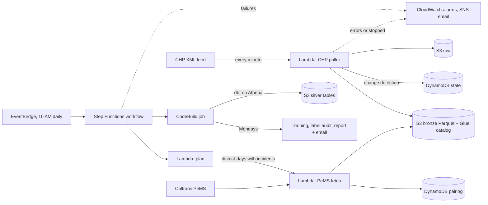

# Predicting Freeway Backups From CHP Incident Reports

When the California Highway Patrol logs a crash on a Southern California freeway, will traffic back up
behind it, and for how long? This project collects every CHP incident and every freeway sensor reading
around it, builds labeled examples on AWS, and trains models to answer both questions from what is
known minutes after the crash is reported.

**Status (October 2026):** the pipeline has been running unattended since September 29. With 13 days
of labeled data, the model predicts **whether** an incident will cause a backup well (AUC 0.73 from
CHP reports and pre-crash traffic alone, 0.89 with live sensor data, both clearly beating a rule-based
baseline). Predicting **how long** a backup lasts is not yet better than chance; the analysis below
explains why and what is being done about it.

---

## Contents

1. [Data sources](#data-sources)
2. [Architecture](#architecture)
3. [From raw feeds to labels](#from-raw-feeds-to-labels)
4. [Features](#features)
5. [Models and evaluation](#models-and-evaluation)
6. [Results so far](#results-so-far)
7. [Checking the labels](#checking-the-labels)
8. [Engineering details](#engineering-details)
9. [What's next](#whats-next)
10. [Repository layout](#repository-layout)
11. [Running it](#running-it)

---

## Data sources

| Source | What it gives | How it's collected |
|---|---|---|
| [CHP live incident feed](https://media.chp.ca.gov/sa_xml/sa.xml) | Every open CHP incident statewide: type, location, coordinates, dispatcher notes (lanes blocked, vehicles, ambulance, tow, SigAlert...), and unit events | Polled **every minute**. The feed only shows *current* incidents, so history exists only from when collection started |
| [Caltrans PeMS](https://pems.dot.ca.gov/) | Speed, flow and occupancy every 5 minutes from thousands of freeway loop detectors, plus sensor locations, lane counts and types (mainline, on/off-ramps, freeway connectors) | Daily files per Caltrans district, downloaded each morning (about a one-day lag) |

Coverage: the 8 Southern California CHP dispatch centers (Caltrans districts 7, 8, 11 and 12: Los
Angeles/Ventura, Inland Empire, San Diego, Orange County), plus the Bay Area (district 4) since
October 13. SoCal alone produces roughly 1,000 to 1,800 CHP incidents a day.

## Architecture

Everything runs in AWS, deployed as one SAM/CloudFormation stack, for a few dollars a month.



| Layer | Tech |
|---|---|
| Ingestion | Python 3.14 Lambdas (requests, pandas, awswrangler), EventBridge Scheduler |
| Orchestration | Step Functions (plan -> fetch each district-day -> report -> process) |
| Storage | S3 data lake (raw / bronze / silver), Parquet, Glue Data Catalog, DynamoDB |
| Transformation | dbt (dbt-athena) on Amazon Athena (Trino SQL), with unit tests and data tests |
| ML | XGBoost (classifier + accelerated-failure-time survival model), scikit-learn, a hand-written log-normal survival model |
| Automation & monitoring | CodeBuild scheduled job, CloudWatch alarms, SNS email |
| Infrastructure as code | AWS SAM / CloudFormation |

**Only paired data is analyzed.** Traffic files are downloaded only for district-days that had CHP
incidents, and CHP incidents are only analyzed when their district-day has traffic data. A small
pairing table tracks each district-day (`pending`, `paired`, `no_incidents`, `unpaired`), so a day
when either collector was down is kept but excluded rather than silently mislabeled.

## From raw feeds to labels

The dbt project (`transform/`) turns the raw tables into one labeled row per incident:

1. **Staging.** Each incident's latest version; freeway and direction parsed from CHP's location
   text. US-101 needs special handling: CHP calls the Valley/Ventura stretch east/west, but PeMS
   calls all of it north/south. Also: dispatcher notes with the time the poller first saw them,
   sensor metadata, and 5-minute readings.
2. **Sensor health.** About two thirds of mainline sensors report imputed (filled-in) values rather
   than real measurements. A sensor only counts on days when at least 80% of its readings were measured.
3. **Which sensors belong to an incident.** The incident is placed on the freeway by its nearest
   mainline sensor. Sensors are then assigned roles relative to the direction of travel:
   - **queue:** 0 to 5 miles upstream, where a backup forms;
   - **approach:** 5 to 10 miles upstream, traffic about to arrive;
   - **merge:** on-ramps and freeway connectors feeding the queue zone;
   - **exit:** off-ramps.

   Postmiles increase northbound and eastbound, so "upstream" is a lower postmile for N/E traffic
   and a higher one for S/W.
4. **What "normal" traffic is.** Each reading's expected speed is the sensor's *typical* speed for
   that 5-minute slot on other weekdays (or weekends), scaled by how traffic was running in the 30
   minutes before the crash. The incident's own day is left out, so the crash's slowdown never
   counts as normal. With fewer than 3 days of history, it falls back to the pre-crash speed.
5. **The label** (`int_backup_slots`, `fct_incident_backup`):
   - A sensor is **backed up** when its speed is below 60% of expected, or when it has no speed but
     is at least 30% occupied (stopped traffic often has no measurable speed).
   - **The queue must start at the crash:** a sensor within 1 mile of the crash must be backed up.
     The queue's length is the unbroken run of backed-up sensors behind it.
   - **Start:** the first time this lasts at least 10 minutes, within 45 minutes of the CHP log time.
   - **End:** the crash site is back above 80% of expected for 15 straight minutes. The gap between
     60% and 80% prevents a brief improvement from ending the backup.
   - **Censored:** still backed up when the data window ends (3 hours) or the sensors stop
     reporting. The true duration is then known to be *at least* that long, and the models treat it
     that way.
6. **Training rows** (`fct_training_landmarks`): one row per incident at 5, 10, 20 and 30 minutes
   after the CHP log time, containing only what was known at that moment, plus the target
   (minutes until traffic is back to normal).

**No look-ahead.** Notes count only once the poller had actually seen them, traffic only once a
5-minute reading had finished, and rows from before the poller first saw an incident are dropped.

## Features

About 60 inputs per row, in six groups. Location identifiers (freeway, dispatch center, district)
are deliberately excluded, so a model can't memorize which corridors happened to have long backups.

| Group | Examples |
|---|---|
| What CHP knows | incident type, lanes blocked now (from the latest note) and how many, all lanes, lanes reopened, vehicles, ambulance, tow, fire, SigAlert, overturned, hazmat, fatality, units assigned / on scene |
| The road | lanes at the crash site and upstream |
| Traffic before the crash | speed, occupancy and flow at the site and across the queue zone, their 15-minute trend, traffic arriving from upstream, on-ramp / connector / off-ramp volume |
| Capacity | share of lanes still open, traffic per lane, **demand vs. capacity left** (vehicles arriving ÷ what the open lanes can carry, at about 2,000 vehicles/hour/lane) |
| Normal congestion at this spot | how slow it usually is now, in 30 and in 60 minutes, and how long until it usually flows freely, all from other days' history |
| Traffic since the crash ("live") | how slow it is now, whether it's backed up, how far back it reaches, minutes backed up so far |

## Models and evaluation

Each question is answered three ways:

| Method | Will it back up? | How much longer? |
|---|---|---|
| **Rule** (baseline) | share of past incidents in the same group (checkpoint, lanes blocked, type) that backed up | median remaining time for that group (Kaplan-Meier, so "still going" cases count as lower bounds) |
| **Boosted** | XGBoost classifier | XGBoost survival model (accelerated failure time) that learns from censored durations |
| **Simple** | logistic regression on 15 features | log-normal survival model with readable effects ("+X% duration per blocked lane") |

The number of trees for the boosted models is chosen by early stopping on held-out days.

Two feature sets are compared:
- **CHP + pre-crash only:** what you'd know from the CHP feed and normal sensor history. Usable in practice.
- **With live traffic:** adds sensor readings since the crash. This needs real-time sensor data,
  which the daily PeMS files don't provide, so it shows an upper bound.

**Leave-one-day-out evaluation:** train on all days but one, predict the held-out day, and repeat for
every day. Every incident gets one out-of-sample prediction, and weekdays and weekends are both
scored. 95% intervals come from **resampling whole days**, because incidents on the same day share
conditions, so days rather than incidents are the honest sample size. The comparison that matters,
each model minus the rule, is resampled in pairs.

Metrics:
- **Will it back up:** AUC, Brier score, and a calibration table (do incidents given a 30% chance
  back up about 30% of the time?).
- **How long:** C-index (0.5 = guessing) on incidents still backed up at the checkpoint, plus median
  error in minutes.

## Results so far

*13 days of data (Sept 29 to Oct 11, 2026). 3,146 labeled incidents, 12,127 training rows; 397
incidents were still backed up at some checkpoint.*

### Will it back up?

| Feature set | Rule | Boosted | Simple | Boosted − rule (95% range) |
|---|---|---|---|---|
| CHP + pre-crash only | 0.60 | **0.73** | 0.66 | +0.12 (+0.08 to +0.15) |
| With live traffic | 0.79 | **0.89** | 0.88 | +0.10 (+0.08 to +0.12) |

<sub>AUC: the chance the model ranks a random incident that backs up above one that doesn't (0.5 = guessing).</sub>

- **Both models clearly beat the rule.** The ranges for the improvement are well above zero.
- **It works early.** From CHP reports and pre-crash traffic alone, AUC is 0.72 already at the
  5-minute checkpoint.
- **The probabilities are trustworthy.** Predicted and actual backup rates match within a few
  points across all probability bands, except the small top band.
- **Without live data, nonlinearity matters.** The boosted model beats the linear one by 0.07 AUC.
  With live traffic the two are equal, because "is it backed up right now" dominates.

### How long?

| Feature set | Rule | Boosted | Simple |
|---|---|---|---|
| CHP + pre-crash only | 0.53 | 0.55 (0.52 to 0.58) | 0.54 |
| With live traffic | 0.53 | 0.54 (0.53 to 0.57) | 0.53 |

<sub>C-index: 0.5 = guessing. Median error is about 23 to 25 minutes for every method.</sub>

**No method ranks backup durations reliably yet.** The simple survival model's effects do make sense,
though:
- **Rush hour:** about 12% longer;
- **More normal congestion still ahead at that spot:** about 13 to 15% longer per standard deviation;
- **Overturned vehicle:** about 60% longer;
- **Weekends:** shorter.

So there is signal. With only about 400 still-going backups to learn from, it doesn't yet survive
out-of-sample testing.

## Checking the labels

Labels built from sensor rules can be quietly wrong, so they were audited before more modeling
(`ml/label_audit.py`). The audit has two parts:

1. **Severity check:** if labels are right, severe incidents should back up more often and longer.
2. **Trace check:** a page with speed charts for random backups, plus "no backup" incidents where CHP
   said lanes were blocked, with the label's start and end drawn on.

The first audit found four kinds of mistakes, all now fixed and covered by unit tests built from the
real cases:

| Problem | Example from the audit | Fix |
|---|---|---|
| Single 5-minute dips counted as backups | a one-reading dip to 59% of expected | backup must last at least 10 minutes |
| Slowdowns 2 to 5 miles back counted even when traffic at the crash was normal | a separate bottleneck kept one "backup" alive for 165 minutes | the queue must start within 1 mile of the crash and be unbroken |
| Recovery declared too early | speeds crawled at about 80% for 15 minutes, then collapsed for two more hours; the label said 5 minutes | recovery requires 80% of expected, not 60% |
| Late starts missed | a drop to 15 mph starting 33 minutes after the log time was labeled "no backup" | onset window widened to 45 minutes |

After the fixes, about 13% of incidents cause a backup (typical length 50 minutes). Severity lines up
the way it should:

| Incident flag | Backed up (yes vs no) | Median minutes (yes vs no) |
|---|---|---|
| SigAlert issued | 50% vs 13% | 55 vs 50 |
| Overturned vehicle | 40% vs 13% | 90 vs 50 |
| Ambulance | 28% vs 12% | 50 vs 50 |
| Tow requested | 23% vs 10% | 55 vs 45 |
| Weekday rush hour | 15% vs 12% | 60 vs 40 |
| Weekend | 11% vs 14% | 35 vs 55 |
| All lanes blocked | 26% vs 13% | **35 vs 50** |

**Why "all lanes blocked" is shorter:** CHP often holds all lanes on purpose for a few minutes (a
"traffic break") to clear debris or let a tow truck work. The note says "all lanes", but the stop is
brief by design. It's a real effect, not a label error.

## Engineering details

- **Change detection.** The poller hashes each incident and writes only new or changed incidents
  (about 5,000 rows a day instead of about 90,000). Closures are detected when an incident has been
  missing for 3 consecutive polls.
- **Overlapping runs can't corrupt state.** State is one DynamoDB item with an optimistic version
  lock. A slower overlapping run that loses the version check exits cleanly as "superseded".
- **Defensive parsing.** An error page or empty document returned with HTTP 200 is rejected instead
  of being read as "every incident closed". One unreadable timestamp doesn't stop a poll.
- **Idempotent loads.** PeMS district-days are written with partition overwrite, so retries and
  reprocessing never duplicate rows. A day that parses to zero rows is retried, not marked done.
- **Monitoring.** Alarms email on poller errors, on the poller stopping (fewer than 30 runs an hour),
  and on any failed daily workflow.
- **Tests.**
  - **Python:** 91 pytest tests, covering parsing, change detection, PeMS, the models, the
    evaluation and the job scripts.
  - **dbt:** 11 unit tests, built from real CHP notes and real audit cases, plus 33 data tests.
  - **Mutation testing:** key label rules were checked by breaking each one on purpose and confirming
    a test fails.
- **Automation.** After each morning's download, a CodeBuild job rebuilds every dbt table. On Mondays
  it also retrains, reruns the label audit, saves a report to S3 and emails a summary. It first
  removes leftover temporary tables from failed dbt runs, so one failure can't block the next day.

## What's next

- **More data.** About 30 new still-backed-up incidents a day, plus the Bay Area since October 13.
  By late November there should be around 2,000, enough to judge duration prediction fairly.
- **Does backup end track CHP closure?** If the end of the backup lines up with CHP closing the
  incident, clearance time drives duration, which would explain why it's hard to predict early.
  CHP closure time could then become a second target.
- **Location history.** With months of data: how long backups at *this* spot usually take.
- **Real-time sensor data.** The "with live traffic" model needs a real-time feed rather than daily
  files.
- **Known limitations:**
  - **Typical-speed history includes later days.** A sensor's typical speed uses other days, some
    after the incident. That's fine for the label, a mild leak for one feature.
  - **Small files accumulate.** The CHP tables gain thousands of small files a day; they need
    periodic compaction.
  - **Daylight-saving gaps.** The repeated 1 AM hour in November is handled approximately.
  - **Connector direction is unknown.** Freeway-connector sensors don't say whether they merge into
    or exit the freeway.

## Repository layout

```
src/                 Lambda code
  chp/               feed download, parsing, change detection, poller handler
  pems/              PeMS client, file parsing, pairing, daily planning/reporting
  common/            settings, S3/Glue helpers
transform/           dbt project (staging -> intermediate -> marts), unit tests in the .yml files
ml/                  models (backup_model.py, simple_models.py), evaluation, training, label audit
jobs/                the scheduled processing job (CodeBuild buildspec and helper scripts)
scripts/             one-off tools: reprocess PeMS files, upload the job code, list dispatch centers
tests/               pytest suite (fixtures include a real CHP feed snapshot)
template.yaml        all AWS infrastructure (SAM)
```

## Running it

Prerequisites: an AWS account with an IAM Identity Center login (profile `traffic` below), AWS CLI,
AWS SAM CLI, Python 3.14, and a free [PeMS account](https://pems.dot.ca.gov/).

```powershell
python -m venv .venv
.\.venv\Scripts\Activate.ps1
pip install -r requirements.txt dbt-athena
python -m pytest -q

# PeMS login, stored encrypted in AWS (never in the code)
aws ssm put-parameter --name /traffic/pems/username --type SecureString --value "<username>" --profile traffic
aws ssm put-parameter --name /traffic/pems/password --type SecureString --value "<password>" --profile traffic

# deploy the stack, then upload the code the scheduled job runs
sam build
sam deploy --guided --profile traffic
python scripts/upload_job_code.py
```

From then on, collection, the daily table rebuild and the weekly report run on their own.
To work locally:

```powershell
$env:LAKE_BUCKET = aws cloudformation describe-stacks --stack-name chp-backup --profile traffic --query "Stacks[0].Outputs[?OutputKey=='LakeBucket'].OutputValue" --output text
cd transform; dbt build --profiles-dir .; cd ..
python ml/train.py --refresh
python ml/label_audit.py --open
```

More detail: [`transform/README.md`](transform/README.md) (models and label rules) and
[`jobs/README.md`](jobs/README.md) (the scheduled job).

---

*Data: California Highway Patrol and Caltrans PeMS. This is an independent student project and is
not affiliated with or endorsed by either agency.*
