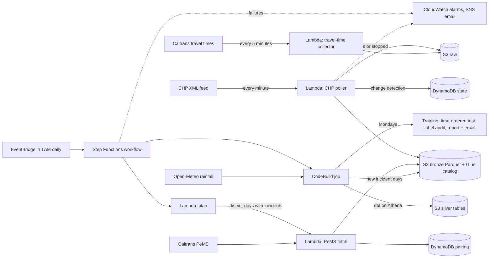

# Predicting Freeway Backups From CHP Incident Reports

When the California Highway Patrol logs a crash on a California freeway, will traffic back up behind
it, and for how long? This project collects every CHP incident and every freeway sensor reading around
it, builds labeled examples on AWS, and trains models to answer both questions from what is known
minutes after the crash is reported.

**Status (October 27, 2026):** the pipeline has collected 28 days of data (8,385 labeled incidents
across Southern California and, since October 13, the Bay Area). Tested the way it would be used,
trained on the first 21 days and predicting the next 7:

| What the model is allowed to see | Model AUC | Rule-based baseline | Improvement (95% range) |
|---|---|---|---|
| **CHP report + normal traffic at that spot** (runs today) | **0.74** | 0.66 | **+0.08** (+0.03 to +0.11) |
| + traffic in the 30 minutes before the crash (needs a real-time sensor feed) | 0.78 | 0.66 | +0.13 (+0.10 to +0.15) |
| + traffic since the crash | 0.91 | 0.81 | not a prediction; see [below](#live-traffic-is-detection-not-prediction) |

The model beats the baseline reliably, but the margin is modest. A round of improvements (duplicate
removal, regularized trees, and a set of feature experiments run only on early days) added a small,
real gain; most ideas didn't help, and the limit now looks like missing data rather than the model
([Section 9](#improving-the-models)). **How long** a backup lasts is only slightly better than the
baseline. The sections below explain the target, the test design, the statistics, the alerting
tradeoff, whether retraining helps, and where the model fails.

---

## Contents

1. [Data sources](#1-data-sources)
2. [Architecture](#2-architecture)
3. [From raw feeds to labels](#3-from-raw-feeds-to-labels)
4. [Prediction target](#4-prediction-target)
5. [Features and when each is available](#5-features-and-when-each-is-available)
6. [Baseline](#6-baseline)
7. [Experimental design](#7-experimental-design)
8. [Statistical inference](#8-statistical-inference)
9. [Results](#9-results)
10. [Missing a backup vs. an unnecessary alert](#10-missing-a-backup-vs-an-unnecessary-alert)
11. [Does weekly retraining help?](#11-does-weekly-retraining-help)
12. [Failure cases](#12-failure-cases)
13. [Checking the labels](#13-checking-the-labels)
14. [Engineering details](#14-engineering-details)
15. [Limitations and what's next](#15-limitations-and-whats-next)
16. [Repository layout](#16-repository-layout)
17. [Running it](#17-running-it)

---

## 1. Data sources

| Source | What it gives | How it's collected |
|---|---|---|
| [CHP live incident feed](https://media.chp.ca.gov/sa_xml/sa.xml) | Every open CHP incident statewide: type, location, coordinates, dispatcher notes (lanes blocked, vehicles, ambulance, tow, SigAlert...), and unit events | Polled **every minute**. The feed only shows *current* incidents, so history exists only from when collection started |
| [Caltrans PeMS](https://pems.dot.ca.gov/) | Speed, flow and occupancy every 5 minutes from thousands of freeway loop detectors, plus sensor locations, lane counts and types (mainline, on/off-ramps, freeway connectors) | Daily files per Caltrans district, downloaded each morning (about a one-day lag) |
| [Open-Meteo](https://open-meteo.com/) | Hourly rainfall on a 0.25° grid (about 25 km) | Fetched each morning for every grid cell and day with CHP incidents; the first run backfilled from September 29 |
| [Caltrans travel times](https://cwwp2.dot.ca.gov/documentation/tt/tt.htm) | Current travel time on selected freeway segments in districts 3, 8, 11 and 12, refreshed every 5 minutes | Saved raw **every 5 minutes** since late October 2026, to build history for a model that runs live (PeMS arrives a day late) |

**Coverage:** the 8 Southern California CHP dispatch centers (Caltrans districts 7, 8, 11 and 12: Los
Angeles/Ventura, Inland Empire, San Diego, Orange County), plus the Bay Area (district 4) since October
13. The feed carries roughly 1,000 to 2,800 incidents a day across these centers. Labeled incidents
by dispatch center: Bay Area 2,099, Inland Empire 2,083, San Diego 2,072, Los Angeles 1,733, Orange
County 214, others under 110.

**Why Los Angeles and Orange County are under-represented.** Los Angeles logs more than twice as many
incidents as any other center, yet has fewer labels. Tracing every incident from the feed to a label
(`scripts/pipeline_status.py`) shows where they drop out: almost all are located on a freeway and near a
sensor, but most have **no working sensor** in the 5 miles behind the crash. PeMS sensors tend to
either measure all day or not at all (filled in by PeMS from neighbors and history), and filled-in
readings can't show a backup:

| Caltrans district | Mainline sensor-days with no real measurements (last 7 days) |
|---|---|
| 7 (Los Angeles / Ventura) | 86% |
| 8 (Inland Empire) | 59% |
| 11 (San Diego) | 58% |
| 12 (Orange County) | 50% |
| 4 (Bay Area) | 45% |

This is a property of the source data, not a pipeline bug, so relaxing the sensor-health rule wouldn't
help (sensors are rarely partly working). Orange County went from 1 label in its first 3 weeks to 214
as its sensors came back. The models only describe crashes on well-instrumented freeway segments.

## 2. Architecture

Everything runs in AWS on serverless services, deployed as one SAM/CloudFormation stack, so it keeps
running with no machine to keep on.



| Layer | Tech |
|---|---|
| Ingestion | Python 3.14 Lambdas (requests, pandas, awswrangler), EventBridge Scheduler, Open-Meteo weather API |
| Orchestration | Step Functions (plan -> fetch each district-day -> report -> process) |
| Storage | S3 data lake (raw / bronze / silver), Parquet, Glue Data Catalog, DynamoDB |
| Transformation | dbt (dbt-athena) on Amazon Athena (Trino SQL), with unit tests and data tests |
| ML | XGBoost (classifier + accelerated-failure-time survival model), scikit-learn, a hand-written log-normal survival model |
| Automation & monitoring | CodeBuild scheduled job, CloudWatch alarms, SNS email, a one-command pipeline health report |
| Infrastructure as code | AWS SAM / CloudFormation |

**Only paired data is analyzed.** Traffic files are downloaded only for district-days that had CHP
incidents, and CHP incidents are only analyzed when their district-day has traffic data. A small
pairing table tracks each district-day (`pending`, `paired`, `no_incidents`, `unpaired`), so a day
when either collector was down is kept but excluded rather than silently mislabeled.

## 3. From raw feeds to labels

The dbt project (`transform/`) turns the raw tables into one labeled row per incident:

1. **Staging.** Each incident's latest version; freeway and direction parsed from CHP's location
   text. US-101 needs special handling: CHP calls the Valley/Ventura stretch east/west, but PeMS
   calls all of it north/south. Also: dispatcher notes with the time the poller first saw them,
   sensor metadata, and 5-minute readings.
2. **Sensor health.** About two thirds of mainline sensors report imputed (filled-in) values rather
   than real measurements. A sensor only counts on days when at least 80% of its readings were measured.
3. **Which sensors belong to an incident.** The incident is placed on the freeway by its nearest
   mainline sensor. Sensors are then assigned roles relative to the direction of travel:
   - **queue:** 0 to 5 miles upstream, where a backup forms;
   - **approach:** 5 to 10 miles upstream, traffic about to arrive;
   - **merge:** on-ramps and freeway connectors feeding the queue zone;
   - **exit:** off-ramps.

   Postmiles increase northbound and eastbound, so "upstream" is a lower postmile for N/E traffic
   and a higher one for S/W.
4. **What "normal" traffic is.** Each reading's expected speed is the sensor's *typical* speed for
   that 5-minute slot on other weekdays (or weekends), scaled by how traffic was running in the 30
   minutes before the crash. The incident's own day is left out, so the crash's slowdown never
   counts as normal. With fewer than 3 days of history, it falls back to the pre-crash speed.
5. **The label** (`int_backup_slots`, `fct_incident_backup`), defined in [Section 4](#4-prediction-target).
6. **Training rows** (`fct_training_landmarks`): one row per incident at 5, 10, 20 and 30 minutes
   after the CHP log time, containing only what was known at that moment, plus the target.
7. **Duplicate reports removed** (`ml/backup_model.py`, before any model sees the data). Freeway
   Service Patrol tow trucks log their own incidents, and about half of those are the same crash CHP
   already logged: same freeway and direction, within 30 minutes, at the same sensor. Both copies get
   the same label, so keeping them counts one crash twice. CHP also occasionally opens a second
   incident for the same crash. Each group of duplicates keeps one report (CHP over FSP, then the
   earliest); 1,189 were dropped, and every duplicate pair had the same label.

**No look-ahead.** Notes count only once the poller had actually seen them, traffic only once a
5-minute reading had finished, and rows from before the poller first saw an incident are dropped.

## 4. Prediction target

**The question is asked at a checkpoint**: 5, 10, 20 or 30 minutes after CHP logs an incident, using
only what was known at that moment.

| | Target | Type |
|---|---|---|
| **Primary** | Will traffic at the crash be backed up at any point after this checkpoint? | binary |
| Secondary | If so, how many more minutes until it is back to normal? | time to event, right-censored |

**Definitions:**
- **Backed up:** the sensor nearest the crash (within 1 mile upstream), and an unbroken run of sensors
  behind it, is below 60% of the speed expected for that spot and time, or at least 30% occupied with
  no speed reading (stopped traffic often has no measurable speed).
- **Start:** the first time this lasts at least 10 minutes, within 45 minutes of the log time.
- **Back to normal:** the crash site is above 80% of expected speed for 15 straight minutes.
- **Censored:** still backed up when the 3-hour window ends or the sensors stop reporting. The
  duration is then known only to be *at least* that long.

About 13% of incidents cause a backup; the typical one lasts 50 minutes.

**Why the target is set up this way:**
- **Asked at a checkpoint, not "at the crash".** A traffic operator decides at a moment in time with
  what is known then. One row per incident per checkpoint gives every row a well-defined information
  set, and the same incident is asked again as more is known. Predicting from the full incident record
  would quietly use notes written after the decision.
- **"Any more backup after now", not "did it ever back up".** At 20 minutes, a backup that already
  ended is no longer actionable. The target covers the two cases that still matter: a backup that
  hasn't started yet and one still going. (The second case is what makes the live-traffic model look
  better than it is; see [Section 9](#live-traffic-is-detection-not-prediction).)
- **Compared to expected speed, not a fixed mph.** 35 mph is a backup at 2 AM and normal on the 405 at
  5 PM. Comparing to the same spot's typical speed for that time slot separates crash-caused slowdowns
  from everyday congestion.
- **60% to start, 80% to end.** The gap stops one brief improvement from ending a backup.
- **Censored backups kept.** Dropping backups that outlast the window would remove exactly the longest
  ones and bias durations short. The survival models use them as lower bounds.

## 5. Features and when each is available

About 60 inputs per row. A feature is only usable if it exists at the checkpoint *in production*, not
just in the historical table, so the models are trained on three feature sets.

| Group | Examples | Available at the checkpoint? | History only | + Pre-crash | + Live |
|---|---|---|:---:|:---:|:---:|
| CHP report | incident type, lanes blocked now (latest note) and how many, all lanes, lanes reopened, vehicles, ambulance, tow, fire, SigAlert, overturned, hazmat, fatality, units assigned / on scene | **Yes**, within about a minute (poller). Only notes seen by the checkpoint count | ✓ | ✓ | ✓ |
| Time | hour, day of week, rush hour, weekend | **Yes** | ✓ | ✓ | ✓ |
| The road | lanes at the crash site and upstream, merge points, sensors in the queue zone | **Yes**, sensor metadata changes rarely | ✓ | ✓ | ✓ |
| Normal congestion at this spot | how slow it usually is now, in 30 and in 60 minutes, minutes until it usually flows freely | **Yes**, from earlier days | ✓ | ✓ | ✓ |
| Normal congestion along the backup zone | slowest sensor 0–5 miles back now / in 30 / in 60 minutes, zone average, share of the zone normally jammed, average 5–10 miles back | **Yes**, from earlier days | ✓ | ✓ | ✓ |
| Rain *(collected, not a model input yet)* | rain in the last 1, 3 and 24 full hours at the incident's grid cell | **Yes**, hourly weather is published in real time | | | |
| Traffic before the crash | speed, occupancy and flow at the site and across the queue zone, their 15-minute trend, traffic arriving from upstream, on-ramp / connector / off-ramp volume, **demand vs. capacity left** (vehicles arriving ÷ what the open lanes carry at about 2,000 vehicles/hour/lane) | **Only with a real-time sensor feed.** This pipeline gets PeMS files the next morning | | ✓ | ✓ |
| Traffic since the crash | how slow it is now, whether it's backed up, how far back it reaches, minutes slowed so far | **Only with a real-time sensor feed** | | | ✓ |

- **CHP + history only** is the model that could run today with this pipeline.
- **CHP + pre-crash** needs same-day sensor data for the 30 minutes before the crash, so it needs a
  near real-time sensor feed, which isn't built yet.
- **+ Live** sees the backup itself forming, so it measures detection, not prediction.

Location identifiers (freeway, district, dispatch center) are deliberately excluded, so a model can't
memorize which corridors happened to have long backups in a few weeks of data.

## 6. Baseline

**Rule:** for a new incident, predict the share of past training incidents in the same group that
backed up, and that group's median remaining time (Kaplan-Meier, so censored backups count as lower
bounds). Groups are checkpoint × lanes blocked (none / 1 / 2+ / all) × incident type, plus "backed up
right now" in the live variant. Groups with fewer than 10 past incidents fall back to a coarser group.

**Why this baseline:** it is the strongest thing you could do without a model, a lookup table a traffic
center could keep by hand, and it already uses the most obvious signals (lanes blocked, incident
type). A model is only worth running if it beats this, so results are reported as **model minus
rule**, not as raw scores.

Two models are compared against it:

| Method | Will it back up? | How much longer? |
|---|---|---|
| **Boosted** | XGBoost classifier | XGBoost survival model (accelerated failure time) that learns from censored durations |
| **Simple** | logistic regression on about 15 features | log-normal survival model with readable effects ("+X% duration per blocked lane") |

## 7. Experimental design

Three evaluations answer three different questions:

| Evaluation | Question | How |
|---|---|---|
| **Forward test** (`ml/forward_test.py`) | How would it have done if deployed on a date, predicting only the future? | Train on every day before October 20, test on October 20–26 |
| **Leave-one-day-out** (`ml/evaluate.py`) | Using all the data, how well does each method rank incidents? | Train on every day but one, predict the held-out day, repeat for all 28 days |
| **Retraining simulation** (`ml/forward_test.py`) | Does retraining every Monday make predictions better? | A model frozen at the first Monday vs. one retrained each Monday, scored on the same later days |

**Time periods:**

| | Dates | Days | Incidents |
|---|---|---|---|
| All data | Sept 29 – Oct 26, 2026 | 28 | 8,385 (32,276 checkpoint rows) |
| Model development (choosing settings and features) | Sept 29 – Oct 14 | 16 | |
| Forward test: training | Sept 29 – Oct 19 | 21 | 5,854 |
| Forward test: testing | Oct 20 – Oct 26 | 7 (Tue to Mon, so every weekday and both weekend days) | 2,531 |
| Final check of the model changes (never used before) | trained before Oct 22, tested Oct 22 – Oct 26 | 5 | 1,753 |
| Retraining: frozen model trained on | Sept 29 – Oct 4 | 6 | Southern California only |
| Retraining: weekly models trained on | everything before Oct 12, Oct 19, Oct 26 | 13, 20, 27 | |
| Retraining: scored on | Oct 12 – Oct 26 | 15 | 21,846 rows |

**Why each choice:**
- **Both a forward test and leave-one-day-out.** Leave-one-day-out uses every day for testing, which
  matters with only a few weeks of data, and keeps each day together. But it trains on days *after* the
  day it predicts, which a real system never can. If something drifts over time (season, construction,
  how CHP writes notes), leave-one-day-out hides it. The forward test is the honest deployment number;
  leave-one-day-out is the more precise one. So far they agree (history only: 0.74 vs. 0.73; pre-crash:
  0.78 both ways), which suggests no drift yet.
- **Model changes chosen on early days only.** Every setting and feature idea was judged on days before
  October 15 (a time-ordered split plus leave-one-day-out within those days). The later days were used
  once, at the end, so the reported gain isn't the best of many tries on the test data.
- **Whole days as the unit of splitting.** Incidents on the same day share weather, events and traffic
  level, and each incident appears at up to four checkpoints. Splitting rows at random would put
  near-copies of a test row in training and inflate every score.
- **A full test week.** Seven consecutive days include every weekday and a weekend, so the test isn't
  tilted toward one kind of day.
- **Alert thresholds fixed before the test days.** Picking the threshold that looks best on the test
  days and reporting precision and recall there is optimistic by construction. Cost-based thresholds
  come from a formula ([Section 10](#10-missing-a-backup-vs-an-unnecessary-alert)); the "catch 80%"
  threshold is chosen on the last fifth of the *training* days by a model fit on the earlier ones.
- **Number of trees chosen on the latest training days.** Early stopping on a random split would reward
  trees that fit day-specific noise. Holding out the most recent days mirrors how the model is used.
- **Three feature sets.** They separate "is the model good" from "is the model usable". A strong score
  that depends on data we won't have at decision time is not a deployable result.
- **A frozen vs. retrained comparison on the same days.** Comparing this week's model to last week's on
  different test weeks would mix "did the model improve" with "was this week easier". Scoring both on
  identical rows isolates the effect of retraining.
- **Primary comparison named in advance:** boosted minus rule, AUC, CHP + history only, forward test.
  Everything else is secondary. Naming one comparison up front keeps the many tables below from becoming
  a search for a good-looking number.

## 8. Statistical inference

**The unit of inference is the day.** All 95% intervals come from a **cluster bootstrap over days**:
resample the test days with replacement, recompute every score on the incidents from those days,
repeat 200 times, and take the 2.5th and 97.5th percentiles. Incident-level intervals would treat
thousands of correlated rows as independent and come out far too narrow. With a 7-day forward test, the
honest sample size is 7, and the intervals are wide accordingly.

**Comparisons are paired.** "Boosted minus rule" and "retrained minus frozen" are computed on the same
resampled days in each bootstrap draw. Day-to-day swings (a heavy-crash Friday) cancel out of the
difference, so the comparison is much more precise than two separate intervals would suggest. A model
is said to beat the rule when the whole interval of the difference is above zero.

**Metrics, and why each:**

| Metric | What it measures | Why it's here |
|---|---|---|
| **AUC** | chance a random incident that backs up is ranked above one that doesn't (0.5 = guessing) | threshold-free, so methods can be compared on ranking alone |
| **Average precision** (area under the precision-recall curve) | precision averaged over all recall levels; guessing scores the backup rate, about 0.13 | backups are rare, and AUC can look fine while most alerts are wrong; this metric shows that |
| **Precision / recall** at a fixed threshold | of alerts sent, how many were real; of real backups, how many got an alert | what an operator actually experiences |
| **Brier score** | mean squared error of the probability | rewards honest probabilities, not just ranking |
| **Calibration table** | do incidents given 30% back up about 30% of the time? | the cost-based alert thresholds assume calibrated probabilities |
| **C-index** (Harrell's) | how often the duration model orders two backups' remaining time correctly (0.5 = guessing) | handles censoring correctly |

**Censoring is handled in every statistic.** Durations still going at the end of the window are never
treated as if they ended there: the rule uses the Kaplan-Meier median, the boosted survival model uses
interval-censored likelihood (a lower bound with no upper bound), the log-normal model uses the
survival function for censored rows, and the C-index only counts pairs whose order is known.

**What "significant" means here.** With a few weeks of data, an interval that includes zero means "not
shown yet", not "no effect". Results are reported as estimates with intervals rather than pass/fail
tests, and the primary comparison is named in advance (above), so one lucky interval out of many isn't
presented as a finding.

**Reproducibility.** Model and bootstrap seeds are fixed, so reruns on the same data give the same
numbers.

## 9. Results

*28 days (Sept 29 – Oct 26, 2026), 8,385 incidents. "95% range" is the day-resampled interval.*

### Will it back up? (forward test: trained on the first 21 days, tested on the last 7)

All checkpoints together:

| Feature set | Method | AUC | Average precision | Precision* | Recall* |
|---|---|---|---|---|---|
| **CHP + history only** | Rule | 0.66 | 0.25 | 0.29 | 0.34 |
| | Boosted | **0.74** | **0.28** | **0.32** | **0.43** |
| | Boosted − rule | **+0.08 (+0.03 to +0.11)** | +0.03 (−0.01 to +0.08) | +0.03 (0.00 to +0.06) | +0.09 (+0.02 to +0.12) |
| **CHP + pre-crash traffic** | Rule | 0.66 | 0.25 | 0.29 | 0.34 |
| | Boosted | **0.78** | **0.35** | **0.35** | **0.50** |
| | Boosted − rule | +0.13 (+0.10 to +0.15) | +0.10 (+0.05 to +0.14) | +0.06 (+0.03 to +0.09) | +0.16 (+0.11 to +0.21) |

<sub>*At the threshold for "a missed backup costs 4× an unnecessary alert" (alert when P > 0.2), fixed in advance; see Section 10.</sub>

- **The model beats the rule in both deployable settings.** The primary comparison (history only,
  +0.08) has its whole interval above zero. With pre-crash traffic the gain is larger.
- **At the same threshold, the model catches more backups with at least as good precision.**
- **The simple model barely beats the rule** without pre-crash traffic (leave-one-day-out +0.01,
  interval spans zero). The gain comes from interactions a linear model can't express, such as
  incident type × time of day × normal congestion.
- **Earlier is about as good as later.** From CHP + history, AUC is 0.72 at the 5-minute checkpoint and
  0.75 at 30 minutes (leave-one-day-out). The useful signal is there from the first report.
- **Leave-one-day-out agrees:** history only 0.73 vs. rule 0.65 (+0.08, +0.06 to +0.10); pre-crash
  0.78 (+0.13, +0.11 to +0.15).
- **Probabilities are calibrated.** Across 28 days of out-of-sample predictions, every probability band
  matches the actual rate within 0.02 for the history-only model (e.g. predicted 0.27, actual 0.29).

### Improving the models

The goal was to make the two deployable models (history only, and pre-crash) better. Every idea was
scored only on days before October 15, two ways: trained before October 8 and tested October 8–14, and
leave-one-day-out within those days. Scores are AUC.

| Change | History only (time split / leave-one-out) | Pre-crash (time split / leave-one-out) | Kept? |
|---|---|---|---|
| Starting point (after removing duplicates) | 0.682 / 0.687 | 0.739 / 0.742 | |
| **Shallower, more regularized trees** (depth 3, ≥20 incidents per leaf, slower learning) | **0.687 / 0.692** | **0.756 / 0.749** | **yes** |
| + incidents in the past 1–3 hours on the same road / in the same district | 0.688 / 0.688 | 0.761 / 0.748 | no |
| + each freeway's past backup rate (from earlier days only) | 0.679 / 0.692 | 0.752 / 0.748 | no |
| + 16 features from CHP's own words (on a ramp or connector, shoulder, big rig, motorcycle, debris, injuries, traffic break...) | 0.680 / 0.694 | 0.759 / 0.749 | no |
| Average of boosted and simple models | 0.694 / 0.692 | 0.758 / 0.745 | no |
| CatBoost instead of XGBoost | 0.700 / 0.691 | 0.760 / 0.728 | no |
| Dropping weak features (day of week, unit counts, sensor counts) | within ±0.005 | | no |

**Second round, after the tables were rebuilt with the new columns** (same development days and splits;
the starting point is higher than in the table above because "typical traffic" for each sensor is now
built from four weeks of other days instead of three, which most likely sharpened both the labels and
the normal-congestion features for the early days):

| Change | History only (time split / leave-one-out) | Pre-crash (time split / leave-one-out) | Kept? |
|---|---|---|---|
| Starting point | 0.707 / 0.706 | 0.755 / 0.755 | |
| **+ normal congestion along the whole backup zone** | **0.716 / 0.719** | **0.761 / 0.763** | **yes** |
| + rain in the last 1, 3 and 24 hours | 0.707 / 0.713 | 0.759 / 0.755 | not yet |
| + both | 0.708 / 0.719 | 0.760 / 0.764 | |

Only changes that helped on both splits were kept. The CHP text was the most promising idea and the
most disappointing: some words do matter on their own (debris: 8% backed up vs. 14%; injuries: 20% vs.
13%), but the model already gets that from incident type, vehicles and ambulance.

**Final check on days never used before** (trained before October 22, tested October 22–26):

| | Before the changes | After | Change (95% range) | vs. rule |
|---|---|---|---|---|
| History only | 0.716 | 0.720 | +0.004 (+0.001 to +0.010) | +0.05 (+0.01 to +0.08) |
| Pre-crash | 0.765 | 0.772 | +0.007 (0.000 to +0.023) | +0.11 (+0.09 to +0.12) |

The improvement is real but small. Removing duplicates mostly made the numbers more honest rather than
higher.

**The zone features on the latest week** (trained before October 21, tested October 21–27): history only
0.736 → 0.737 (+0.001, −0.010 to +0.012); pre-crash 0.782 → 0.782. They helped on the development days
but make no measurable difference on the newest week. They stay in the models because they're computed
anyway and cost nothing at prediction time, but they aren't counted as an improvement.

**Rain** isn't used yet. Only about 15% of rows had any rain in the previous 24 hours, mostly light, and
the few rainy incidents backed up *less* often (8% vs. 14%), probably because traffic was already slow
and the "typical speed" baseline doesn't know it's raining. It needs a real rainy season before it can
be judged; the pipeline collects it every day. (These rain numbers used values stamped one hour late, a
bug since fixed, and will be re-checked once the stored rainfall is fetched again.) With these inputs the models seem close to their limit; the levers left are more and better
data ([Section 15](#15-limitations-and-whats-next)).

### Live traffic is detection, not prediction

With traffic since the crash, AUC is 0.91 (rule 0.81). That number is real, but it does not measure
*prediction*. The target counts backups already underway, and in the test week 44% of rows that go on
to have more backup are already backed up at the checkpoint. "Is it backed up right now" alone scores
0.72.

Scoring only rows that were **not yet backed up** at the checkpoint:

| Feature set | Model AUC, all rows | Model AUC, not yet backed up | Rule, not yet backed up |
|---|---|---|---|
| CHP + history only | 0.74 | 0.72 | 0.65 |
| CHP + pre-crash | 0.78 | 0.75 | 0.65 |
| + Live | 0.91 | 0.85 | 0.66 |

Even here, the live model scores 0.85 because it sees speeds already falling toward the backup
threshold. That's useful (an automatic detector that fires before the label's 10-minute rule), but it
is detecting a forming queue, not predicting one from the report. The headline numbers in this README
are therefore the history-only and pre-crash models.

### How long?

| Feature set | Rule C-index | Boosted C-index | Boosted − rule | Median error (boosted vs rule) |
|---|---|---|---|---|
| CHP + history only | 0.55 | 0.58 | +0.04 (+0.02 to +0.06) | 22 vs 23 min |
| CHP + pre-crash | 0.55 | 0.59 | +0.04 (+0.02 to +0.07) | 21 vs 23 min |

<sub>Leave-one-day-out C-index on rows still backed up at the checkpoint (0.5 = guessing). The forward test agrees for history only (+0.03, 0.00 to +0.06).</sub>

Duration is still hard. Both models now beat the rule (with 28 days the intervals are above zero), but
a C-index near 0.58 ranks durations only a little better than chance. The simple survival model's
effects make sense:

- **Weekends:** about 27% shorter;
- **Overturned vehicle:** about 46% longer;
- **Ambulance:** about 13% longer;
- **More minutes of normal congestion still ahead at that spot:** about 4% longer per standard deviation;
- **All lanes blocked:** about 36% *shorter* (CHP "traffic breaks", see [Section 13](#13-checking-the-labels)).

## 10. Missing a backup vs. an unnecessary alert

A probability only becomes useful once someone decides when to act on it. The two mistakes cost
different things:

- **Missed backup:** drivers keep heading into a queue nobody warned them about; the tail of the queue
  is where secondary crashes happen; diversion and response start late.
- **Unnecessary alert:** a message sign or app warning for traffic that never stopped. Each one is
  cheap, but many of them teach operators and drivers to ignore alerts, which makes the real ones worth
  less.

**Choosing a threshold.** If a missed backup costs *k* times an unnecessary alert, alerting has lower
expected cost whenever *p* × *k* > (1 − *p*), that is, when *p* > 1 / (1 + *k*). This only works if *p*
is calibrated, which is why the calibration check above matters. The thresholds come from this formula,
not from the test data.

At the 5-minute checkpoint, CHP + history only, over the 7 test days (about 310 incidents and 43
backups a day):

| Missed backup costs | Alert when P > | Precision | Recall | Alerts / day | Missed backups / day | Unneeded alerts / day |
|---|---|---|---|---|---|---|
| 1× an unneeded alert | 0.50 | 0.35 | 0.04 | 5 | 41 | 3 |
| 2× | 0.33 | 0.37 | 0.15 | 18 | 36 | 11 |
| **4×** | **0.20** | **0.32** | **0.41** | **55** | **25** | **37** |
| 9× | 0.10 | 0.22 | 0.72 | 142 | 12 | 111 |
| catch 80% (set on training days) | 0.09 | 0.21 | 0.76 | 156 | 10 | 124 |
| *Rule at 4×* | *0.20* | *0.29* | *0.36* | *53* | *27* | *37* |
| *Rule at 9×* | *0.10* | *0.17* | *0.74* | *186* | *11* | *155* |
| *CHP + pre-crash at 4×* | *0.20* | *0.37* | *0.44* | *50* | *24* | *32* |

**The practical tradeoff:**
- **There is no setting that is both quiet and complete.** Catching three quarters of backups means
  about 140 alerts a day, four out of five of them unnecessary. Even the strictest setting is right only
  about a third of the time, and then it catches fewer than one backup in six.
- **Where the model beats the rule depends on the setting.** At 4×, it sends about as many alerts with
  the same number of unneeded ones, and misses 2 fewer backups a day. At 9×, it catches about as many
  backups as the rule with **44 fewer unneeded alerts a day**, which is where it helps most.
- **For a traffic operations dashboard,** a missed backup is plausibly 4 or more times worse than an
  extra item on a list someone glances at.
- **For public warnings** (message signs, navigation apps), false alarms cost trust, so a cost ratio
  near 2× is more realistic, and at that setting the model warns about only one backup in seven.
- **The better use right now is ranking, not alarms.** Sorting the day's incidents by probability puts
  the backups near the top: the riskiest 10% (about 32 a day) hold 23% of backups, the riskiest fifth
  holds 46%, and the riskiest half holds 76%. An operator can work down the list instead of trusting a
  hard cutoff.
- **Real-time pre-crash traffic is worth more than any threshold choice:** at the same 4× setting it
  catches more backups (44% vs. 41%) with fewer unneeded alerts (32 vs. 37 a day).

## 11. Does weekly retraining help?

The scheduled job retrains every Monday. That only matters if it changes predictions for the better,
so the retraining simulation compares, on the same rows (October 12–26):

- **Frozen:** trained once on Sept 29 – Oct 4 and never updated;
- **Weekly:** retrained on Oct 12, Oct 19 and Oct 26 on all data so far.

| Feature set | Frozen AUC | Weekly AUC | Weekly − frozen (95% range) |
|---|---|---|---|
| CHP + history only | 0.716 | 0.731 | +0.015 (−0.002 to +0.032) |
| CHP + pre-crash | 0.757 | 0.780 | +0.023 (+0.006 to +0.036) |
| + Live | 0.900 | 0.913 | +0.013 (+0.007 to +0.019) |

The rule barely changes with retraining (+0.005), and Brier scores improve by at most 0.004.

**Where the gain comes from.** Two things changed between the frozen and weekly models: more days, and
the Bay Area (added October 13, so the frozen model never saw it). Splitting the test rows by region:

| | Frozen | Weekly |
|---|---|---|
| Southern California, history only | 0.710 | 0.731 |
| Southern California, pre-crash | 0.744 | 0.782 |
| Bay Area, history only | 0.727 | 0.734 |
| Bay Area, pre-crash | 0.776 | 0.777 |

The gain is in Southern California, where the frozen model had only 6 days of history. The model
trained only on Southern California worked just as well in the Bay Area, so it transfers across regions.

**Learning curve.** The same test week (Oct 20–26), predicted from the most recent N training days:

| Training days | 3 | 5 | 7 | 10 | 14 | 21 |
|---|---|---|---|---|---|---|
| History only | 0.699 | 0.713 | 0.733 | 0.747 | 0.738 | 0.736 |
| Pre-crash | 0.736 | 0.749 | 0.760 | 0.778 | 0.771 | 0.783 |

**Conclusion:** retraining helps while the history is short, and the help comes from *more data*, not
from the world changing: leave-one-day-out and the forward test agree, and there's no sign of drift
over four weeks. The curve rises until about 10 days and is flat after that. So the weekly job now
**only replaces the current model when the retrained one is at least as good** (`ml/promote.py`): it
trains this week's code on everything except the latest 7 days, scores it against the current model on
those 7 days (which neither has seen), and keeps whichever ranks them better. The decision and its
interval go into the weekly email.

## 12. Failure cases

From the forward test, CHP + history only, at the 5-minute checkpoint and the 4× threshold:

| | Caught backups | Missed backups | Unneeded alerts | Correctly no alert |
|---|---|---|---|---|
| Incidents | 122 | 176 | 262 | 1,641 |
| Lane blocked (per CHP notes) | 55% | **34%** | 48% | 25% |
| 2 or fewer working sensors behind the crash | 3% | **18%** | 13% | 22% |
| Label from a partial baseline | 7% | **14%** | 5% | 13% |
| Weekday rush hour | 57% | 48% | 55% | 35% |
| Normally congested at this time | 34% | 18% | **24%** | 10% |
| Traffic already slower than usual before the crash | 16% | 11% | **17%** | 7% |
| Median backup length | 50 min | 48 min | | |

**What it misses:**
1. **Backups CHP hasn't described.** Two thirds of missed backups had no lane-blocked note at 5
   minutes. The model leans on the CHP report, so a crash reported only as "1125, traffic hazard" with
   no detail looks harmless. AUC when there are no notes yet: 0.63.
2. **Thinly instrumented spots.** 18% of missed backups had 2 or fewer working sensors behind the
   crash, vs. 3% of caught ones, and twice as many rest on a partial "typical traffic" baseline. Some
   of these misses are probably label noise rather than model error.

**Where it raises unneeded alerts:**
1. **Severe-looking crashes in heavy traffic.** Unneeded alerts are mostly lanes-blocked crashes at
   rush hour, and they're more than twice as likely as correct no-alerts to be at a spot that is
   normally congested at that time (24% vs. 10%) or already slower than usual (17% vs. 7%). The label
   compares to *typical* speed, so where it's normally jammed, a crash may not push speeds below 60% of
   an already low baseline. AUC where traffic was already slow: 0.60; normally congested: 0.67.
2. **SigAlerts.** Only 35 rows in the test week, 31% backed up, and the model can't tell which ones will
   clear quickly (AUC 0.50).

Night crashes are no longer a weak spot with more data (AUC 0.83): they rarely back up, and the model
gets that right.

## 13. Checking the labels

Labels built from sensor rules can be quietly wrong, so they were audited before more modeling
(`ml/label_audit.py`). The audit has two parts:

1. **Severity check:** if labels are right, severe incidents should back up more often and longer.
2. **Trace check:** a page with speed charts for random backups, plus "no backup" incidents where CHP
   said lanes were blocked, with the label's start and end drawn on.

The first audit found four kinds of mistakes, all now fixed and covered by unit tests built from the
real cases:

| Problem | Example from the audit | Fix |
|---|---|---|
| Single 5-minute dips counted as backups | a one-reading dip to 59% of expected | backup must last at least 10 minutes |
| Slowdowns 2 to 5 miles back counted even when traffic at the crash was normal | a separate bottleneck kept one "backup" alive for 165 minutes | the queue must start within 1 mile of the crash and be unbroken |
| Recovery declared too early | speeds crawled at about 80% for 15 minutes, then collapsed for two more hours; the label said 5 minutes | recovery requires 80% of expected, not 60% |
| Late starts missed | a drop to 15 mph starting 33 minutes after the log time was labeled "no backup" | onset window widened to 45 minutes |

Severity still lines up the way it should with 28 days (8,385 incidents):

| Incident flag | Backed up (yes vs no) | Median minutes (yes vs no) |
|---|---|---|
| SigAlert issued | 48% vs 13% | 70 vs 50 |
| Overturned vehicle | 35% vs 13% | 65 vs 50 |
| Ambulance | 30% vs 12% | 55 vs 50 |
| Tow requested | 23% vs 11% | 50 vs 50 |
| Any lane blocked | 20% vs 10% | 50 vs 50 |
| Weekday rush hour | 16% vs 12% | 55 vs 45 |
| Weekend | 11% vs 14% | 35 vs 55 |
| All lanes blocked | 28% vs 13% | **35 vs 50** |

**Why "all lanes blocked" is shorter:** CHP often holds all lanes on purpose for a few minutes (a
"traffic break") to clear debris or let a tow truck work. The note says "all lanes", but the stop is
brief by design. It's a real effect, not a label error.

## 14. Engineering details

- **Change detection.** The poller hashes each incident and writes only new or changed incidents
  (about 5,000 rows a day instead of about 90,000). Closures are detected when an incident has been
  missing for 3 consecutive polls.
- **Overlapping runs can't corrupt state.** State is one DynamoDB item with an optimistic version
  lock. A slower overlapping run that loses the version check exits cleanly as "superseded".
- **Defensive parsing.** An error page or empty document returned with HTTP 200 is rejected instead
  of being read as "every incident closed", and a download cut off mid-document is retried (on
  October 28 the CHP feed started returning cut-off files for hours). One unreadable timestamp
  doesn't stop a poll.
- **Idempotent loads.** PeMS district-days are written with partition overwrite, so retries and
  reprocessing never duplicate rows. A day that parses to zero rows is retried, not marked done.
- **Automation.** After each morning's download, a CodeBuild job rebuilds every dbt table. On Mondays
  it also retrains, runs the time-ordered test (forward test, alert tradeoff, retraining comparison,
  failure cases), replaces the stored model only if the retrained one is at least as good, reruns the
  label audit, saves everything to S3 and emails a summary. It first
  removes leftover temporary tables from failed dbt runs, so one failure can't block the next day.
- **Monitoring.** Alarms email on poller errors, on the poller stopping (fewer than 30 runs an hour),
  on the travel-time collector failing for an hour,
  and on any failed daily workflow. `scripts/pipeline_status.py` prints one report covering every
  stage: firing alarms, whether the alert email is confirmed, runs and errors per hour for both
  collectors with their latest error messages, recent workflow and job runs with the
  error from the latest failure, row counts per day from raw incidents through training rows, sensor
  health by district, and how many incidents each dispatch center loses at each step on the way to a
  label.
- **Tests.**
  - **Python:** 114 pytest tests, covering parsing, change detection, PeMS, the models, both
    evaluations, duplicate removal, model promotion, the rainfall download, the travel-time collector and
    the job scripts.
  - **dbt:** 13 unit tests, built from real CHP notes and real audit cases, plus data tests.
  - **Mutation testing:** key label rules were checked by breaking each one on purpose and confirming
    a test fails.

**Outage, October 14–22.** Collection kept running, but no new incidents were labeled for 8 days.
Three problems stacked up:
1. The scheduled job's code had never been uploaded to S3, so every run failed before starting.
2. Once it was uploaded, dbt failed replacing a view: the job's IAM role could create Glue tables but
   not read and prune a view's old versions (`glue:GetTableVersions`), which dbt-athena needs the
   second time it builds a view.
3. The failure alerts weren't reaching the inbox; the email subscription had to be sent again and
   confirmed.

The fixes: the missing permissions plus a test that keeps them, the health report above, and a
confirmed alert subscription. Because raw data is kept, nothing was lost; one rebuild labeled all 8 days,
and the daily job has run cleanly every day since.

## 15. Limitations and what's next

**Limitations:**
- **Short history.** 28 days cover one season. The forward test is a single week, so a holiday or storm
  in it would move every number.
- **Labels come from sensors.** A backup the sensors can't see (no working sensor within a mile) isn't
  in the data, so results apply to well-instrumented freeway segments. Most Los Angeles sensors never
  report real measurements ([Section 1](#1-data-sources)), so Los Angeles is under-represented.
- **Pre-crash and live results assume a real-time feed** the pipeline doesn't have yet.
- **Typical speed uses later days too.** A sensor's typical speed for a slot is built from other days,
  some after the incident. That's right for the label but a mild look-ahead for the normal-congestion
  features; in deployment they would come only from earlier days.
- **Retraining evidence is thin.** Three retraining points can show a large effect or rule one out, but
  not detect a small one.

**What's next:**
- **Real-time sensor data,** which turns the pre-crash model (0.78) into something deployable. This is
  the largest available gain, bigger than everything in [Improving the models](#improving-the-models).
- **Use the Caltrans travel times** once there are a few weeks of them: a live "how slow is it right
  now" signal for San Diego, Orange County and the Inland Empire.
- **Rain, after the rainy season starts:** both as a model input and in the label's "expected speed",
  which today doesn't know it's raining.
- **Does backup end track CHP closure?** If it does, clearance time drives duration, which would
  explain why duration is hard to predict early. CHP closure time could become a second target.
- **Location history:** with months of data, how long backups at *this* spot usually take.
- **Housekeeping:** compact the many small CHP files; handle the November daylight-saving hour
  exactly; work out which way freeway-connector sensors merge.

## 16. Repository layout

```
src/                 Lambda code
  chp/               feed download, parsing, change detection, poller handler
  pems/              PeMS client, file parsing, pairing, daily planning/reporting
  caltrans/          real-time travel-time collector
  common/            settings, S3/Glue helpers
transform/           dbt project (staging -> intermediate -> marts), unit tests in the .yml files
ml/                  models (backup_model.py, simple_models.py), leave-one-day-out evaluation
                     (evaluate.py, train.py), time-ordered evaluation (forward_test.py), model
                     promotion (promote.py), label audit
jobs/                the scheduled processing job (CodeBuild buildspec, rainfall download, helper scripts)
scripts/             pipeline health report, upload the job code, reprocess PeMS files, list dispatch centers
tests/               pytest suite (fixtures include a real CHP feed snapshot)
template.yaml        all AWS infrastructure (SAM)
```

## 17. Running it

Prerequisites: an AWS account with an IAM Identity Center login (profile `traffic` below), AWS CLI,
AWS SAM CLI, Python 3.14, and a free [PeMS account](https://pems.dot.ca.gov/).

```powershell
python -m venv .venv
.\.venv\Scripts\Activate.ps1
pip install -r requirements.txt dbt-athena
python -m pytest -q

# PeMS login, stored encrypted in AWS (never in the code)
aws ssm put-parameter --name /traffic/pems/username --type SecureString --value "<username>" --profile traffic
aws ssm put-parameter --name /traffic/pems/password --type SecureString --value "<password>" --profile traffic

# deploy the stack, then upload the code the scheduled job runs
sam build
sam deploy --profile traffic
python scripts/upload_job_code.py
```

Confirm the "AWS Notification - Subscription Confirmation" email, or no alerts will reach you. From
then on, collection, the daily table rebuild and the weekly report run on their own. To check on it or
work locally:

```powershell
python scripts/pipeline_status.py     # is every stage healthy, and where did data stop?
python ml/train.py --refresh          # download the training table, leave-one-day-out evaluation
python ml/forward_test.py             # forward test, alert tradeoff, retraining, failure cases
python ml/promote.py                  # replace ml/models/current only if the retrained model is as good
python ml/label_audit.py --open       # severity table and speed-trace page
```

More detail: [`transform/README.md`](transform/README.md) (models and label rules) and
[`jobs/README.md`](jobs/README.md) (the scheduled job).

---

*Data: California Highway Patrol and Caltrans PeMS. This is an independent student project and is
not affiliated with or endorsed by either agency.*
